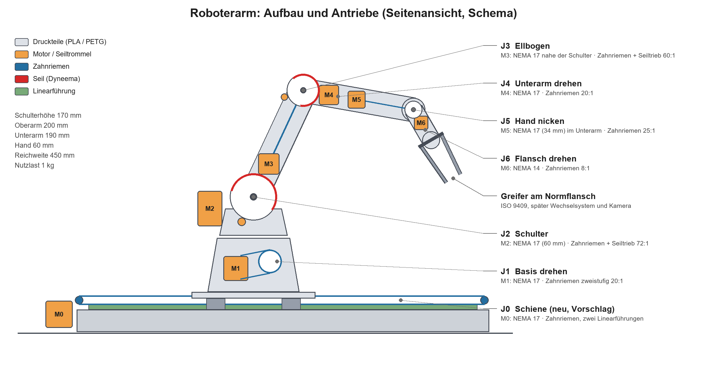

# KI-integrierter Roboterarm

Selbst konstruierter 6-Achs-Desktop-Roboterarm: 3D-gedruckt (PLA/PETG, BambuLab A1), NEMA-17-Schrittmotoren, Standardteile von AliExpress. Später mit Kamera-KI und automatischem Greiferwechsel.

## Eckdaten (Ziel)

| | |
|---|---|
| Achsen | 6 (Knickarm mit Zentralhand) + Schiene als 7. Achse, koordiniert |
| Reichweite | 450 mm (Schulter → Flansch) |
| Nutzlast | 1 kg im ganzen Arbeitsraum |
| Wiederholgenauigkeit | ≤ ±0,5 mm (unidirektional, nach Referenzfahrt, bei gleichbleibender Last) |
| Steuerung | BTT Octopus (STM32F446) + grblHAL, 7 synchrone Achsen, TMC2209, 24 V |
| Software | Python auf dem PC (Kinematik, Bahnplanung, später Kamera/KI) |

Der Arm steht später auf einer angetriebenen Schiene mit 1000 mm Verfahrweg (Stufe C).

## Stand

Phase 0 (Projektgerüst) abgeschlossen. Phase 1 (Detailkonzept) abgeschlossen: Kinematik und [Lastrechnung](docs/lastrechnung.md) stehen, Gutachten 8/10. Als Nächstes: Phase 2, Getriebe-Prüfstand (J2-Modul) und [Motorvermessung](docs/motorvermessung.md). Der vollständige Plan mit allen Phasen steht in [docs/konzept.md](docs/konzept.md).

## Aufbau des Repos

| Ordner | Inhalt |
|---|---|
| `docs/` | Anforderungen, Konzept, Parameter, Lastrechnung, Stückliste, Bauanleitung, Prüfprotokolle |
| `cad/` | Exporte aus Fusion 360 (STL, STEP) und Renderings für die Anleitung |
| `firmware/` | Konfiguration für grblHAL |
| `software/` | Python-Paket für Kinematik, Simulation und Steuerung |

## Arbeitsweise

- Konstruiert wird in Fusion 360 auf dem lokalen PC; ins Repo kommen nur Exporte und Renderings.
- Jede Idee und jede Baugruppe wird von einem unabhängigen Gutachter mit 1–10 bewertet (höchstens 3 Runden). Die Protokolle liegen in `docs/reviews/`.
- Die Dokumentation wächst in jeder Phase mit.
