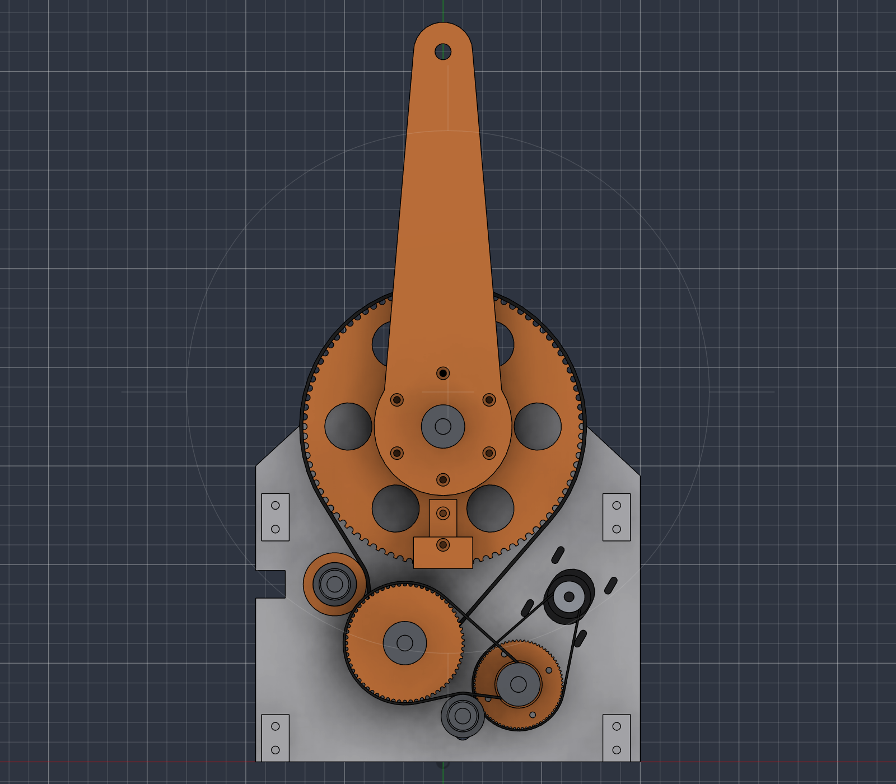

# KI-integrierter Roboterarm

Selbst konstruierter 6-Achs-Desktop-Roboterarm: 3D-gedruckt (PLA/PETG, BambuLab A1), NEMA-17-Schrittmotoren, Standardteile von AliExpress. Später mit Kamera-KI und automatischem Greiferwechsel.

## Eckdaten (Ziel)

| | |
|---|---|
| Achsen | 6 (Knickarm mit Zentralhand) + Schiene als 7. Achse, koordiniert |
| Reichweite | 450 mm (Schulter → Flansch) |
| Nutzlast | 1 kg im ganzen Arbeitsraum |
| Wiederholgenauigkeit | ≤ ±0,5 mm (unidirektional, nach Referenzfahrt, bei gleichbleibender Last) |
| Steuerung | BTT Octopus (STM32F446) + grblHAL, 7 synchrone Achsen, TMC2209, 24 V |
| Software | Python auf dem PC (Kinematik, Bahnplanung, später Kamera/KI) |

Der Arm steht später auf einer angetriebenen Schiene mit 1000 mm Verfahrweg (Stufe C).

## Stand

Stand vom 12.10.2026. Der vollständige Plan steht in [docs/konzept.md](docs/konzept.md).

**Abgeschlossen**
- Phase 0 (Projektgerüst) und Phase 1 (Detailkonzept): Kinematik und [Lastrechnung](docs/lastrechnung.md) stehen, 13 Tests grün.
- Gutachten: Gesamtkonzept 8/10, Detailkonzept 8/10, Steuerung für 7 Achsen 8/10 (Protokolle in `docs/reviews/`).
- Entscheide: 1 kg Nutzlast im ganzen Arbeitsraum; Schiene als 7. Achse, koordiniert mit dem Arm; alle Achsen nur über Zahnriemen (GT2 und HTD), kein Seiltrieb; Steuerung BTT Octopus + grblHAL.
- Motorprüfstand ohne Kaufteile: [Bauanleitung (PDF)](docs/bauanleitung/Bauanleitung_Motorpruefstand.pdf), Messungen in [Motorvermessung](docs/motorvermessung.md); Skript `cad/skripte/motorpruefstand.py`, STL und Druckeinstellungen in `cad/export/stl/Motorpruefstand/`, [Stückliste](docs/stuecklisten/motorpruefstand.md). Ersetzt den alten Messhebel.
- Rohbau des ganzen Roboters nur zur Anschauung (kein Konzept): `cad/skripte/rohbau_gesamt.py`, Bild `cad/renders/Rohbau_Gesamt_iso.png`.
- **CAD des Prüfstands für das Schultergelenk J2** ([Beschreibung](docs/pruefstand-j2.md)): drei Riemenstufen in zwei Ebenen, Spannrollen, Lasthebel, Messzeiger und Messuhrhalter. Gutachten nach drei Runden 8/10 (`docs/reviews/2026-10-12-pruefstand-j2.md`). Exporte in `cad/export/`, die Geometrie entsteht aus `cad/skripte/j2_pruefstand.py`.

**Nächster Schritt** (Stand Ende des zweiten Arbeitstags, 12.10.2026)
1. **Netzteil entscheiden** (siehe unten) – offen.
2. Ritzel, Riemen und Kleinteile des Prüfstands bestellen ([vollständige Stückliste](docs/stuecklisten/pruefstand-j2.md)); dort die Positionen mit Status «klären» mit dem Nutzer durchgehen. Sicher offen sind rund 57 CHF, dazu das Netzteil.
3. Motoren vermessen (`docs/motorvermessung.md`) – geht schon mit den vorhandenen Teilen.
4. Toleranz-Testteil konstruieren und drucken: Lagersitz, Einschmelzgewinde (auch in der 8-mm-Kante), Nabenbohrungen, je ein Zahnsegment der drei Riemenprofile. **Das Testteil gibt es noch nicht; vom Nutzer noch nicht freigegeben.**
5. Gelieferte Ritzel nachmessen, Masse im Skript anpassen, dann die Scheiben und den Rest drucken und den Prüfstand aufbauen.

**Offen: Netzteil 24 V**
- Der Nutzer hat **kein 24-V-Netzteil** (frühere Angabe im README war falsch). Vorhanden und bestätigt (14.10.2026) ist ein Netzteil 12 V / 4 A; es reicht für die Motorvermessung und die Messungen im Stillstand (Spiel, Steifigkeit, Haltetest). Für den Arm mit dem Octopus bleibt das 24-V-Netzteil offen.
- Das Budget ist knapp: Das Markengerät Mean Well GST280A24 (rund 80 CHF) ist dem Nutzer zu teuer.
- Empfohlene Daten: 24 V Konstantspannung, 10 A Dauerstrom (240 W), geschlossenes Tischnetzteil mit Schutzleiter, Ausgang mit offenen Kabelenden (1,5 mm²), CE mit Prüfbericht; 10-A-Sicherung in der Plusleitung. 15 A sind unnötig. Der Bedarf (4–6 A dauernd, Spitzen bis 10 A) ist geschätzt, nicht gemessen.
- Stand der Abklärung: (a) Der Nutzer will bei einem Hersteller ein Muster kaufen; dieser hat bisher weder Modellnummer noch Datenblatt noch Preis genannt – vor dem Bezahlen Bestätigung und Typenschild prüfen. (b) Bastelgarage S-360-24 (24 V / 15 A, CHF 43.90, ausverkauft): vermutlich Einbaunetzteil im Blechkäfig mit Schraubklemmen, die 230-V-Seite muss selbst verdrahtet werden; angeboten ist ein gedrucktes Gehäuse mit Kaltgerätebuchse. Offene Frage an den Nutzer: Kann jemand die Netzseite anschliessen oder prüfen? (c) Markengerät 24 V / 5 A (Leicke, 32,99 EUR) als sichere, kleinere Lösung.

**Beschaffung für den Schulter-Test**
- Laut früherem Stand vorhanden bzw. bestellt (**mit dem Nutzer neu abzugleichen**): NEMA 17 mit 60 mm (ca. 0,7 Nm), Delock-Adapter auf Schraubklemmen, M3-Schrauben; ausgewählt: Kugellager 608ZZ, Einschmelzgewinde M3 × 4 × 5.
- Offene Rückfragen an den Nutzer: Wicklungswiderstand der drei vorhandenen Motoren (17CS04A-170E); Schultermotor mit Doppelwelle (-SZ) oder normal; Multimeter und Lötkolben vorhanden? Sind Schrauben M3 × 16, × 20, × 25 und × 30 im Sortiment? Netzteil 12 V / 4 A vorhanden?
- In Fusion (Dokument «Claude Roboterarm v1», gespeichert) sind der verworfene Seiltrieb-Rahmen (`ALT_Rahmen_Seiltrieb`) und der Messhebel nur ausgeblendet.
- Das Repo ist öffentlich: <https://github.com/Technoraily/KI-Integrierter-Roboter>, Projektseite <https://technoraily.github.io/KI-Integrierter-Roboter/> (`index.md`); sie wird bei jedem neuen Stand nachgeführt.

## Aufbau des Repos

| Ordner | Inhalt |
|---|---|
| `docs/` | Anforderungen, Konzept, Parameter, Lastrechnung, Kostenübersicht, Stücklisten je Baugruppe, Bauanleitung, Prüfprotokolle |
| `cad/` | Exporte aus Fusion 360 (STL, STEP), Renderings für die Anleitung, Skripte, die Baugruppen in Fusion aufbauen |
| `firmware/` | Konfiguration für grblHAL |
| `software/` | Python-Paket für Kinematik, Simulation und Steuerung |

## Arbeitsweise

- Konstruiert wird in Fusion 360 auf dem lokalen PC; ins Repo kommen nur Exporte und Renderings.
- Jede Idee und jede Baugruppe wird von einem unabhängigen Gutachter mit 1–10 bewertet (höchstens 3 Runden). Die Protokolle liegen in `docs/reviews/`.
- Zu jeder Baugruppe gehört eine vollständige Stückliste in `docs/stuecklisten/`: Druckteile, Kaufteile, jede Schraube, Elektrik, Messmittel, Werkzeug und Verbrauchsmaterial, jeweils mit Status (da / offen / klären).
- Die Dokumentation wächst in jeder Phase mit.
