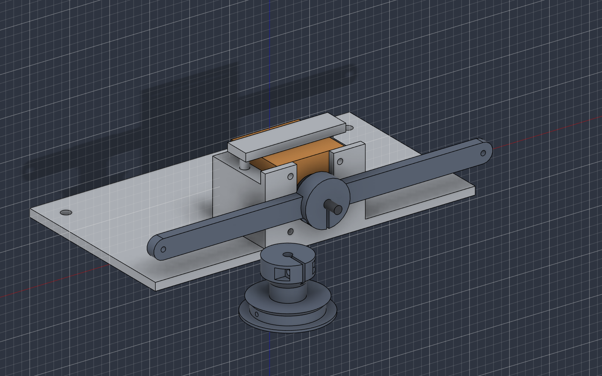
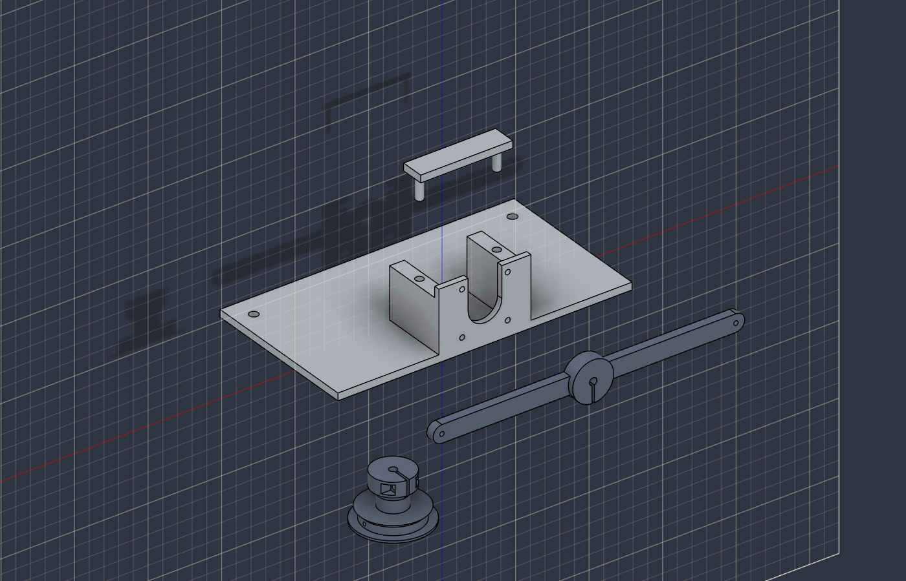
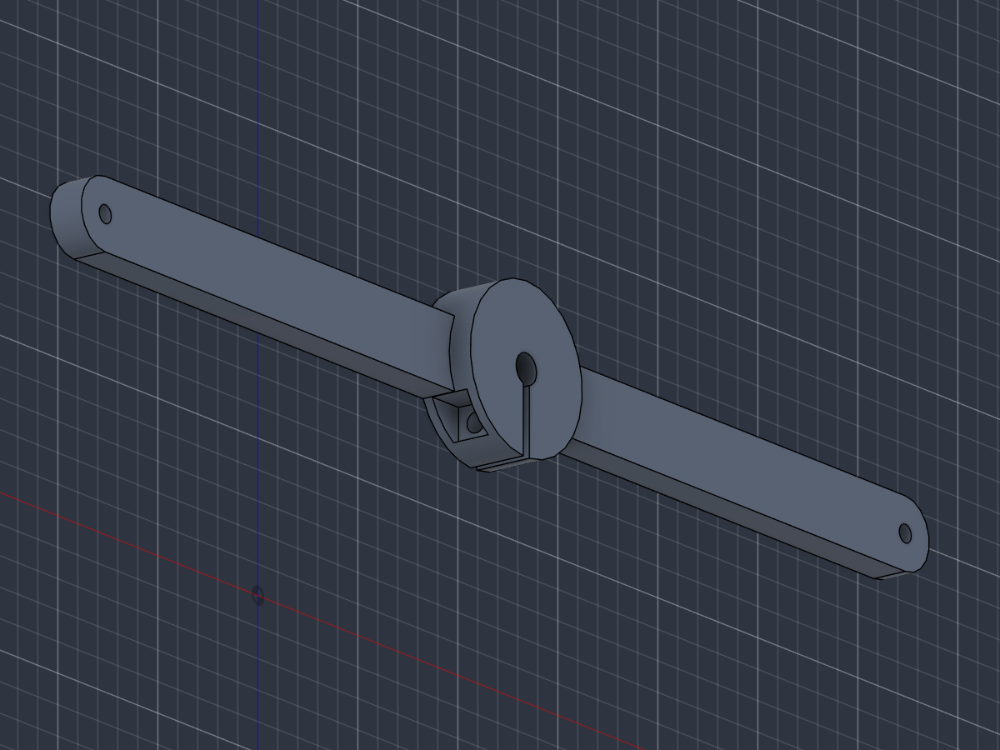
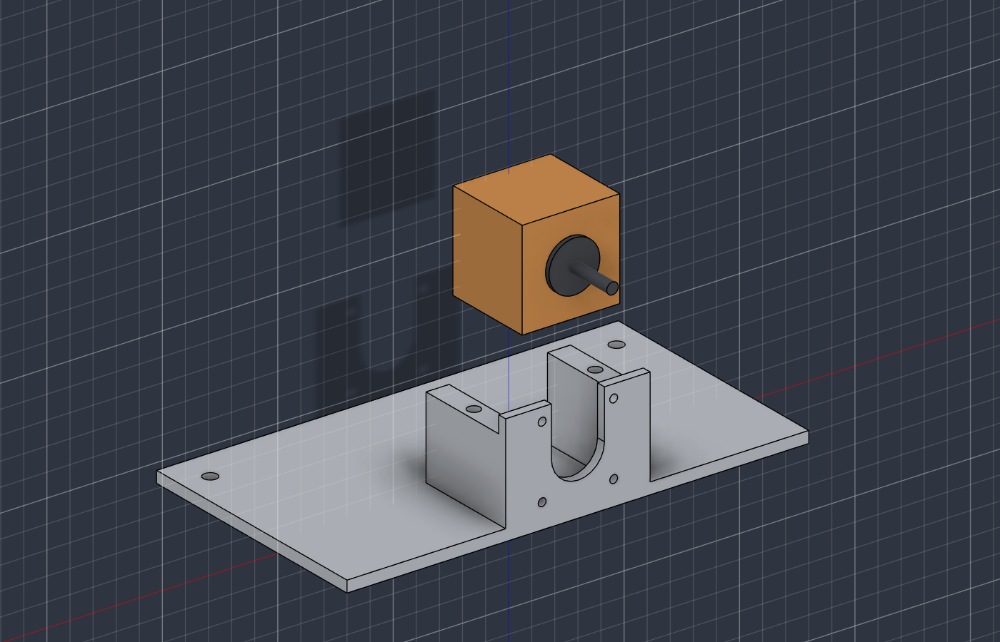
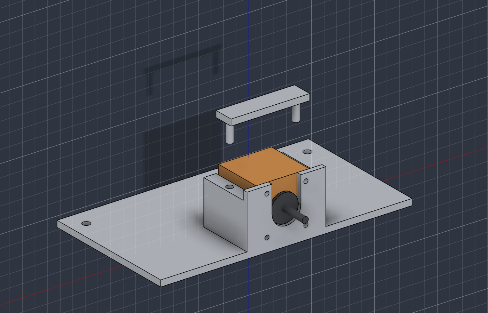
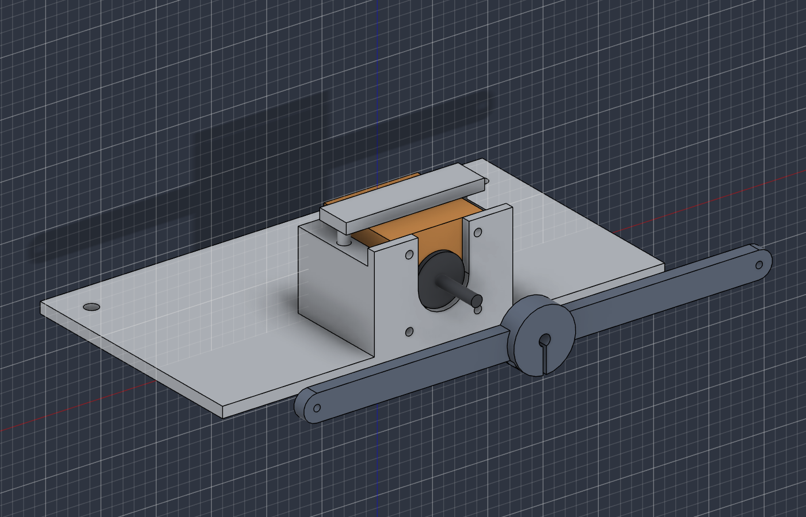
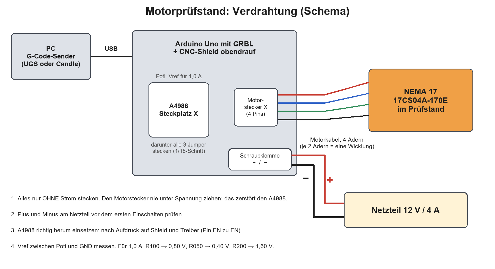
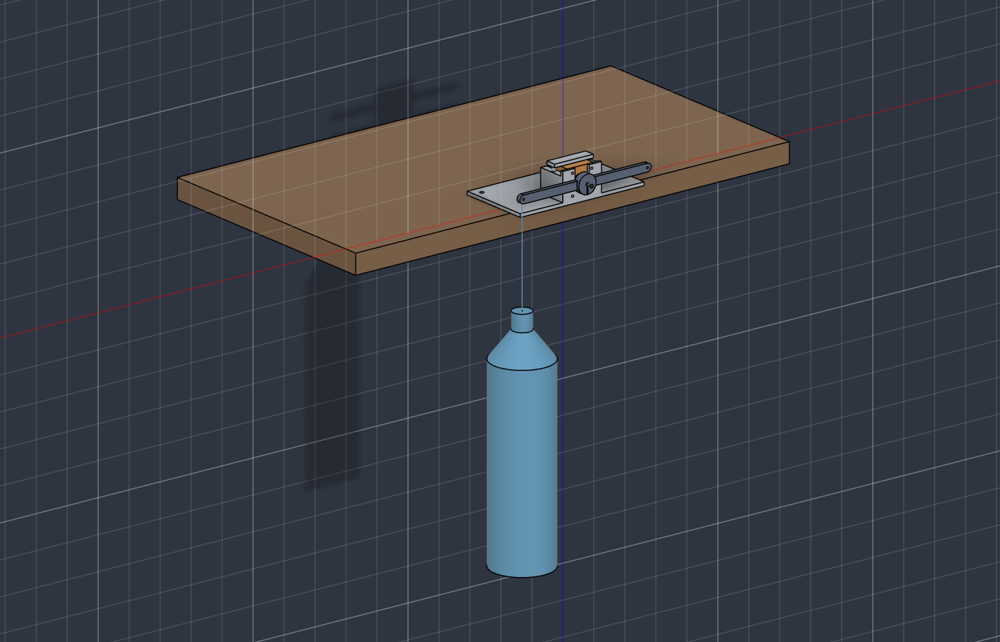
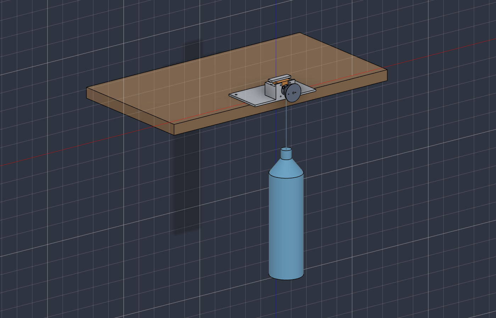

# Bauanleitung: Motorprüfstand NEMA 17

Stand 14.10.2026. Damit misst du deine vorhandenen Motoren, ohne etwas zu kaufen. Die Messungen selbst stehen in [motorvermessung.md](../motorvermessung.md), alle Teile in der [Stückliste](../stuecklisten/motorpruefstand.md). CAD: `cad/skripte/motorpruefstand.py`, Fusion-Dokument «Nema 17 Prüfstand 40mm».

## Was du brauchst

| | Teil | Status |
|---|---|---|
| Druckteile | Motorhalter, Niederhalter, Waagebalken, Seiltrommel | drucken |
| Schrauben | 1–2 × M3 × 16 mit Mutter; optional 4 × M3 × 8–10 | da |
| Elektrik | NEMA 17, Arduino Uno mit GRBL, CNC-Shield, A4988, Netzteil 12 V / 4 A | da |
| | Motorkabel, USB-Kabel, G-Code-Sender auf dem PC (UGS oder Candle, kostenlos) | bitte nachsehen |
| Messen | Küchenwaage, Multimeter, Handy mit Wasserwaage-App | Waage da, Multimeter nachsehen |
| Haushalt | 2 × PET-Flasche 1,5 l, Tasche, ca. 2 m Schnur (1 mm), Klebeband, Tuch | Haushalt |
| Aufstellung | Schraubzwinge oder mindestens 4 kg Bücher | nachsehen |
| Werkzeug | Inbus bzw. Schraubendreher für M3, kleiner Schraubendreher für das Poti | nachsehen |

## Schritt 1: Teile drucken

| Datei (`cad/export/stl/Motorpruefstand/`) | Lage auf dem Druckbett | Einstellungen |
|---|---|---|
| `Motorhalter.stl` | Grundplatte unten (wie exportiert) | PLA, 3 Wände, 30 % Infill, keine Stützen |
| `Niederhalter.stl` | **im Slicer umdrehen**: Platte unten, Zapfen oben | PLA, **100 % Infill** (Zapfen) |
| `Waagebalken.stl` | flach, Nabe oben (wie exportiert) | PLA, 4 Wände, 40 %, keine Stützen |
| `Seiltrommel.stl` | Aussenflansch unten (wie exportiert) | PLA, 4 Wände, 40 %, keine Stützen |

Danach Fäden und Reste aus Schlitzen, Taschen und Bohrungen entfernen. Die 5,1-mm-Bohrung der Naben muss sich leicht auf die Motorwelle schieben lassen; sonst mit einem 5-mm-Bohrer von Hand nachdrehen.

## Schritt 2: Klemmung an den Naben vorbereiten

Jede Nabe hat einen Schlitz und quer dazu ein Loch für die M3-Schraube.
1. Die M3-Mutter seitlich in die rechteckige Tasche schieben.
2. Die M3 × 16 von der Gegenseite durchstecken und zwei, drei Umdrehungen eindrehen. **Noch nicht anziehen.**

Bei der Seiltrommel genauso.

## Schritt 3: Motor einlegen

Den Motor von oben in die Wiege legen:
- Der Kabelstecker zeigt nach hinten, zur offenen Seite.
- Der runde Bund vorne am Motor steckt im Schlitz der Stirnwand, die Stirnfläche liegt an der Wand an.
- Optional: mit vier M3 × 8–10 durch die Löcher der Stirnwand in den Motor schrauben. Nötig ist das nicht, weil die Wiege das Gegenmoment über die Kanten hält.

## Schritt 4: Niederhalter aufstecken

Den Niederhalter mit den zwei Zapfen oben in die Löcher der Seitenwände stecken. Er liegt auf dem Motor und verhindert, dass der Motor herausspringt.

## Schritt 5: Waagebalken aufstecken

1. Den Waagebalken auf die Welle schieben, mit der flachen Seite des Balkens zur Stirnwand. **1–2 mm Luft** zur Stirnwand lassen, damit nichts schleift.
2. Hat die Welle eine Abflachung, gehört der Schlitz der Nabe darüber.
3. Die M3-Schraube anziehen, bis sich der Balken von Hand nicht mehr auf der Welle verdreht. Nicht mit Gewalt, sonst reisst die Nabe.

## Schritt 6: Verdrahten

**Alles nur ohne Strom stecken.**
1. Das CNC-Shield auf den Uno stecken.
2. Unter Steckplatz X alle drei Mikroschritt-Jumper stecken.
3. Den A4988 in Steckplatz X setzen, richtig herum nach Aufdruck (Pin EN zu EN). Falsch herum zerstört ihn das beim Einschalten.
4. Das Motorkabel an den 4-Pin-Stecker X.
5. Das Netzteil 12 V an die Schraubklemme des Shields. **Plus und Minus prüfen.**
6. USB vom Uno zum PC.

**Den Motorstecker nie ziehen oder stecken, solange Spannung anliegt.** Das zerstört den A4988.

## Schritt 7: Strom einstellen und Wärmetest

1. Das Netzteil einschalten.
2. Mit dem Multimeter die Spannung zwischen dem Poti des A4988 und GND messen (Vref).
3. Mit einem kleinen Schraubendreher auf den Wert für **1,0 A** drehen. Welcher Wert das ist, hängt vom Widerstand auf dem Treiber ab:

| Aufdruck auf dem Treiber | Vref für 1,0 A |
|---|---|
| R100 | 0,80 V |
| R050 | 0,40 V |
| R200 | 1,60 V |

4. **Wärmetest:** Im G-Code-Sender verbinden (115200 Baud), dann `$1=255` senden und `G91 G0 X1`. Der Motor bleibt jetzt bestromt. 5 Minuten warten. Wird der A4988 so heiss, dass man ihn nicht anfassen kann, oder lässt der Motor zwischendurch los, braucht es einen Kühlkörper oder Lüfter.

## Schritt 8: Aufstellen

1. Die Grundplatte so auf den Tisch legen, dass ihre Vorderkante (Seite mit Welle und Balken) **20 mm über die Tischkante** ragt.
2. Hinten mit der **Schraubzwinge** durch eines der zwei Löcher festmachen. Ohne Zwinge: mindestens 4 kg Bücher hinten auf die Platte legen und zusätzlich mit der Hand drücken.
3. Ein Tuch oder einen Karton unter die Stelle legen, wo die Flasche hängt.

## Schritt 9: Last anhängen

- **Test A (Haltemoment):** eine Schnurschlaufe durch das Loch am Ende des Waagebalkens (100 mm von der Welle) und die Flasche fest am Hals anbinden. Ablauf: [Test A](../motorvermessung.md#test-a-haltemoment).
- **Tests B und C (Seilwinde):** den Waagebalken abnehmen und die Seiltrommel genauso aufklemmen (Schritt 5). Die Schnur durch das radiale Loch der gewünschten Stufe und das axiale Loch nach aussen fädeln, unter dem Aussenflansch verknoten und **einlagig nebeneinander** aufwickeln. Ablauf: [Test B](../motorvermessung.md#test-b-moment-bei-drehzahl-seilwinde).

## Bilder neu erzeugen

Die Bilder 01–07 entstehen aus `cad/skripte/motorpruefstand_bilder.py` in Fusion, das Verdrahtungsbild aus `docs/bauanleitung/bilder/verdrahtung_motorpruefstand_zeichnen.py`.
