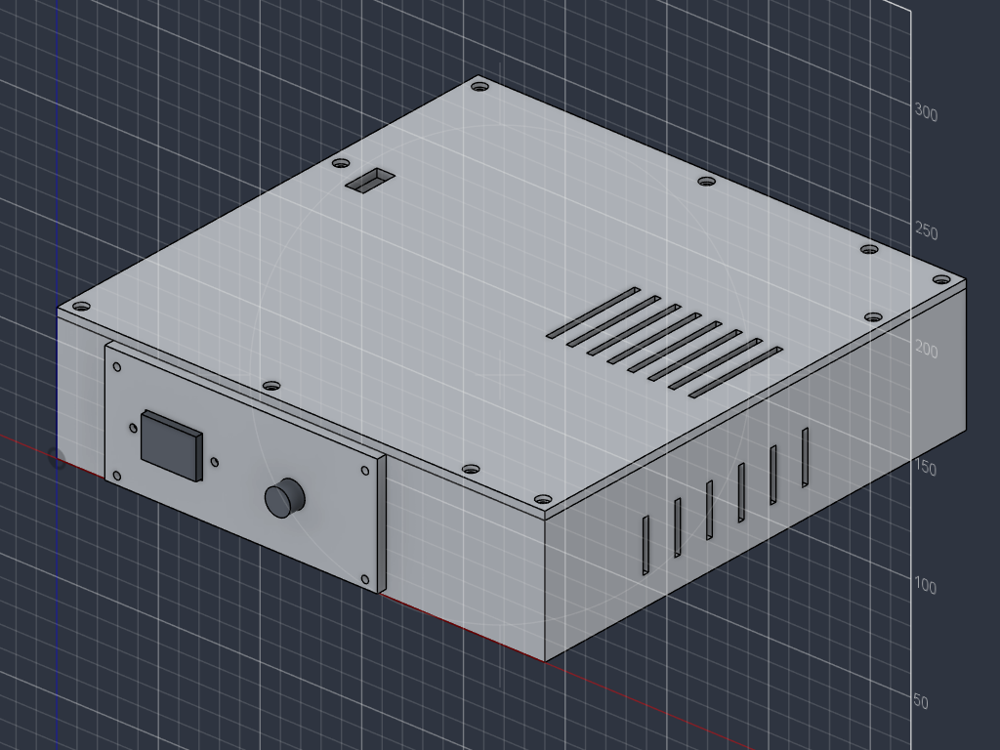
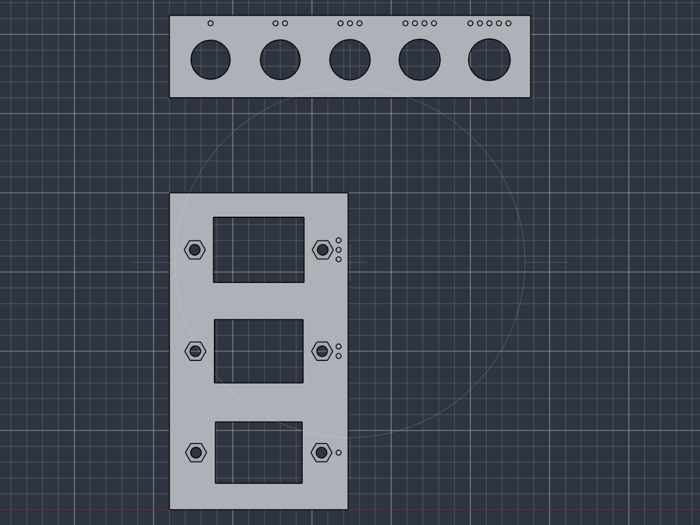
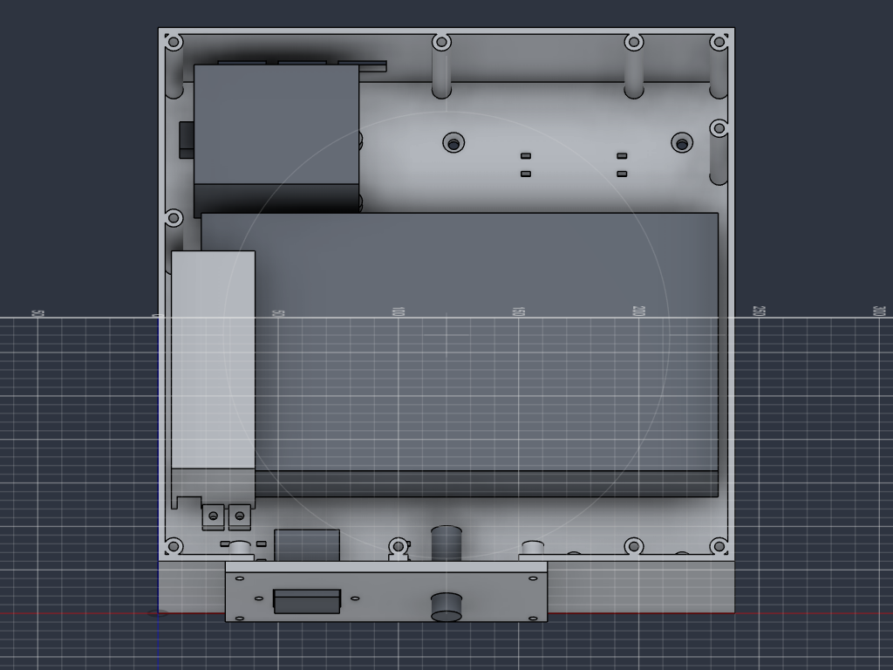

# Elektronikgehäuse J2-Prüfstand

Ein Gehäuse für die gesamte Elektronik des J2-Prüfstands: Netzteil Mean Well LRS-350-24, Arduino Uno mit CNC-Shield und TMC2209, Netzeingang C14 und Sicherung F1. Es hat feste Schraubpunkte für alle Teile und eine Abdeckung über der offenen Klemmleiste des Netzteils (Ringschuhe), damit nichts Spannungsführendes berührbar ist. Schema und Leitungen: `docs/schema/verdrahtung-j2.md`.

**Stand 28.10.2026: Entwurf. Nicht drucken und nicht mit Netzspannung betreiben, bevor Opa die 230-V-Seite freigegeben hat und die Masse unter «Zu messen» an den gekauften Teilen geprüft sind.**

CAD: `cad/skripte/elektronikgehaeuse.py` (alle Masse stehen oben als Konstanten; Ausführen in Fusion wie bei den anderen Skripten). STL: `cad/export/stl/Elektronikgehaeuse/` mit `Druckeinstellungen.md`. Stückliste: `docs/stuecklisten/elektronikgehaeuse.md`.

## Passproben (zuerst drucken, je unter einer Stunde)

Zwei eigenständige Testplatten, 5 mm dick wie die Netzblende, ohne Wanne. Sie zeigen mit einem einzigen Druck, welches Mass an den gekauften Teilen passt.

| Datei | Inhalt | So wird geprüft |
|---|---|---|
| `EG_Passprobe_C14` (56 × 100 × 5) | Drei Stufen für den C14: Ausschnitt 27,4 × 19,4 / 28,0 × 20,0 / 28,6 × 20,6 mm, Lochabstand der Schrauben 39,6 / 40,0 / 40,4 mm, mit Sechskanttaschen für M3. Die Stufe steht als Zahl der Grübchen an der rechten Kante: **1 Grübchen = kleinste, 3 = grösste Stufe** (unten bis oben im Bild) | C14 von der **glatten Unterseite** (die beim Drucken auf dem Bett lag) in den Ausschnitt stecken, wie später von aussen in die Frontwand. Er soll ohne Gewalt hineingehen, aber nicht wackeln. Dann die beiden Schrauben durch Flansch und Platte in die Muttern drehen (Muttern in die Taschen auf der Oberseite einlegen). Die Stufe notieren, bei der beides passt |
| `EG_Passprobe_F1` (114 × 26 × 5) | Fünf Bohrungen Ø 12,4 / 12,6 / 12,8 / 13,0 / 13,2 mm, von links nach rechts aufsteigend: **1 bis 5 Grübchen über der Bohrung** | Sicherungshalter von der Unterseite durchstecken und mit seiner Mutter von oben festschrauben. Die kleinste Bohrung wählen, durch die das Gewinde ohne Gewalt geht. Prüfen, ob die Mutter mindestens zwei Gewindegänge fasst (Blende 5 mm dick) und ob der Halter eine Abflachung hat (dann Rückmeldung, die Bohrung wird D-förmig) |
| `EG_Netzteil_Schablone` (62 × 121 × 2,5) | Flache Schablone fürs Netzteil, **nicht begutachtet**: Fenster 30 × 93,5 mm = Innenraum der Haube (x −10 bis 20, y −2 bis 91,5 ab der vorderen linken Netzteilecke), dahinter 1,2 mm Rückwand, dann ein Schlitz für Poti und LED und zwei Löcher Ø 4,5 über den Gewinden M4 am Klemmenende | Mit der glatten Seite nach unten so auf das Netzteil legen, dass ihre Kante an der Netzteilecke anliegt (Klemmleiste links, Klemme 1 vorne, wie im Gehäuse). Ringschuhe auf den Klemmen **nicht** montieren, aber Klemmleiste, Schrauben, Ohren dürfen nirgends die Schablone berühren; Poti und LED müssen im Schlitz sichtbar sein; die Löcher müssen mit den Gewinden fluchten. Sonst Länge, Breite und Poti-Lage ausmessen und im Skript nachführen, bevor die Haube gedruckt wird |

Danach die Zahlen im Skript `cad/skripte/elektronikgehaeuse.py` nachführen (`C14_B`, `C14_H`, `C14_LOCH`, `D_F1`) und nur die Netzblende neu drucken. Fällt keine Stufe passend aus (alle zu eng oder zu lose), die gemessenen Werte (Ausschnitt, Lochabstand, Gewindedurchmesser) angeben; die Stufen werden dann neu verteilt.

## Teile

| Teil | Aussenmass (mm) | Aufgabe |
|---|---|---|
| `EG_Wanne` | 240 × 238 × 60 | Boden 5 mm, Wände 3 mm; trägt Netzteil, Arduino und alle Schraubpunkte |
| `EG_Deckel` | 240 × 238 × 10 | Platte 4 mm mit Lippe 2 × 6 mm unter dem Rand (links, rechts, hinten); Verschluss mit zehn Schrauben M3 (nur mit Werkzeug zu öffnen), Lüftungsschlitze über dem Lüfter, Zugang zum Poti V ADJ; druckt mit der Oberseite nach unten |
| `EG_Netzblende` | 134 × 57 × 5 | Frontwand mit C14 und Sicherungshalter F1; einzeln nachdruckbar |
| `EG_Klemmenabdeckung` | 35 × 107 × 46 | Haube über der Klemmleiste des Netzteils |

Alle Teile liegen in Druckorientierung (z = 0 unten) und passen mit höchstens 240 mm Kantenlänge auf das Bett des A1.

## Anordnung innen (Innenmasse 234 × 232 mm, Boden bei z = 0)

| Baugruppe | Lage innen (x / y) | Befestigung |
|---|---|---|
| Netzteil 215 × 115 × 30 | 15 / 46 bis 230 / 161, auf Pads 2,5 mm | 4 × M4 × 6 von unten durch den Boden, Senkung Ø 8,2 × 4 mm im Boden. **Die Gewinde im Netzteil sind nur 3 mm tief: nie längere Schrauben als M4 × 6** (2,5 mm greifen) |
| Klemmleiste (Netzteil links, Klemmen 1 bis 9 von vorne nach hinten) | Haube über 5 / 44 bis 35 / 136 | Haube auf dem Boden und auf dem Netzteil, 2 Laschen vorne mit M3 × 10, Mutter in einer Tasche im Boden (von oben eingelegt; Schraubenspitze bündig mit der Unterseite) |
| Arduino Uno + Shield | 12 / 169 bis 80,6 / 222,3, USB links | 4 Dome 6 mm hoch (Ø 8), Einschmelzgewinde M3, Schrauben M3 × 6; der Uno wird zuerst allein verschraubt, dann das Shield aufgesteckt |
| Netzblende | Frontwand, x 28 bis 162 | 4 × M3 × 16 von aussen in Einschmelzgewinde in Domen hinter der Wand |
| Deckel | auf den Wänden | 10 × M3 × 10 in Einschmelzgewinde in Domen (4 Ecken, 2 bei x = 195 vorne und hinten, 1 hinten bei x = 115, 1 vorne bei x = 100 auf einem Wandsteg im Frontausschnitt, 2 an den Seiten bei y = 150 links und y = 190 rechts); Bohrung 10 mm tief. Vorne betragen die Schraubenabstände höchstens 98 mm; seitlich und hinten können wegen Netzteil und Haube keine Dome stehen (Abstände bis 186 mm). Dort steift die Lippe (2 × 6 mm, 0,3 mm innerhalb der Wand, um die Dome ausgespart) den Rand. Wie gut das hält, zeigt erst der Druck |
| Frei | Boden hinten rechts, Frontstreifen rechts | Platz für F2 (Kfz-Sicherung) und Lüsterklemmen 24 V in der Schale `EG_Halter_24V` (80 × 26 × 12, mit den beiden Kabelbinderpaaren bei x = 150 und 190 am Boden festgebunden; Schale und Mass sind eine allgemeine Annahme, nicht begutachtet, Halter und Klemmen noch nicht gemessen); je zwei Kabelbinderschlitze (3,8 × 2,2) bei x = 150 und x = 190, y = 195; drei weitere Paare vorne bei x = 25, 40 und 100, y = 22 für die Netzkabel zum Kabelgang |

- **Auf ein Brett schrauben:** vier Löcher Ø 4,5 mm mit Senkung Ø 9 (innen bei 120 / 205, 215 / 205, 170 / 18, 215 / 18; ausserhalb von Netzteil, Arduino und Haube) für M4 oder Holzschrauben. Dazu muss der Deckel ab.
- **Öffnungen:** links die USB-Öffnung (30 × 15 mm, gross, weil die Lage der Buchse nicht geprüft ist), hinten drei Kabelöffnungen 20 × 12 mm für das Motorkabel, rechts sechs Lüftungsschlitze 3 × 24 mm, im Deckel acht Lüftungsschlitze (3 × 50 mm) über dem Lüfter des Netzteils (Lage aus dem Datenblatt).
- **Zugang zur Spannungseinstellung:** ein Schlitz 9 × 18 mm im Deckel über Poti V ADJ und LED (Lage aus dem Datenblatt ausgemessen). Die 24,0 V werden bei geschlossenem Gehäuse mit einem isolierten Schraubendreher eingestellt, ohne dass 230-V-Teile offenliegen.
- **Waagrechte Bohrungen in Tropfenform:** Die vier Einschmelzbohrungen hinter der Netzblende liegen waagrecht (Saggen, siehe `docs/parameter.md`); sie sind deshalb tropfenförmig mit der Spitze nach oben.
- **Frontwand:** Der Ausschnitt hinter der Netzblende ist nach oben offen, damit keine Brücke von 110 mm gedruckt werden muss. Ein 8 mm breiter Wandsteg bei x = 100 (zwischen C14 und F1) trägt einen Deckeldom und stützt den Deckelrand. Die Netzblende reicht bis unter den Deckel und schliesst ihn.

## Berührschutz der Klemmleiste

Die Klemmleiste (Klemmen 1 bis 3 = L, N, Schutzleiter; 4 bis 9 = −V, +V) liegt oben am linken Ende des Netzteils offen. Die Klemmenabdeckung deckt sie ab:

- Die Haube reicht links 10 mm über das Netzteil hinaus. Dieser **Kabelgang** (10 mm breit, vom Boden bis zum Dach) nimmt die Kabel der Ringschuhe auf. Sie laufen im Gang nach vorne (Klemmen 1 bis 3, Netz, zu C14 und F1) bzw. nach hinten (Klemmen 4 bis 9, 24 V, zum Shield) und treten durch zwei unten offene Schlitze (10 × 14 mm) in den Stirnwänden der Haube aus. Weil die Schlitze nach unten offen sind, lässt sich die Haube nach dem Verdrahten von oben über die Kabel setzen.
- Die linke Wand der Haube ist geschlossen. Die Haube steht links auf dem Boden und rechts auf dem Netzteil, vorne mit zwei Laschen festgeschraubt.
- Das Poti V ADJ bleibt hinter der Haube frei (Rückwand 1,2 mm dick, Aussenfläche bei 92,7 mm, Poti ab 93,2 mm: nur 0,5 mm Luft, nach der Zeichnung, am Gerät nachmessen) und ist nur durch den Deckelschlitz erreichbar. Die Rückwand ist so dünn, damit die Haube den Ringschuh der Klemme 9 (reicht bis etwa 90 mm) noch aufnimmt.
- Der Deckel ist die zweite Schutzstufe: Ohne Werkzeug (Schraubendreher) ist von aussen nichts erreichbar.
- Die Kabelschuhe: Gabel oder Ring (siehe `verdrahtung-j2.md`). Für den Schutzleiter und die Netzklemmen ist ein geschlossener Ringschuh sicherer, weil er sich nicht lösen kann, ohne dass die Schraube ganz entfernt wird.

## Montage (Reihenfolge)

1. Passproben drucken: `EG_Passprobe_C14` und `EG_Passprobe_F1` (siehe oben, je unter einer Stunde) und die Konstanten im Skript nachführen. Danach `EG_Netzblende` und `EG_Klemmenabdeckung` (zusammen etwa 3 h) drucken und mit C14, Sicherungshalter und Netzteil probieren; bei Abweichungen nur diese Teile neu drucken. Erst danach Wanne und Deckel.
2. **Vor dem Einbau am Netzteil:** Umschalter 115/230 V auf 230 V stellen (liegt an der Vorderfläche, danach nicht mehr erreichbar) und mit Klebeband sichern; Typenschild prüfen. Poti V ADJ noch nicht verstellen.
3. Einschmelzgewinde M3 (18 Stück) mit dem Lötkolben setzen: 4 Arduino-Dome, 10 Deckeldome, 4 Netzblenden-Dome (Einsatz von der freien Domenseite).
4. C14 mit zwei Schrauben von aussen durch die Blende in die Muttern (Mutterntaschen innen) schrauben; Sicherungshalter F1 mit seiner Mutter. Netzblende von aussen an die Wanne schrauben (M3 × 16).
5. Wanne auf zwei Leisten legen, die unter den Wänden liegen, sodass der Boden unten frei ist. Netzteil von oben einlegen und von unten mit vier M4 × 6 anschrauben (vorher eine Schraube probeweise ins Netzteil drehen: höchstens 3 mm Eingriff).
6. Uno allein mit vier M3 × 6 auf die Dome schrauben, danach das CNC-Shield aufstecken. Treiber TMC2209 einsetzen, Vref einstellen (`docs/grbl-j2.md`).
7. Verdrahten nach `docs/schema/verdrahtung-j2.md`: Schutzleiter zuerst. Ringschuhe auf die Klemmen, Kabel nach links in den Kabelgang, dort nach vorne (Netz) bzw. hinten (24 V). Netzkabel mit Kabelbindern in den vorderen Schlitzen fixieren.
8. Zwei Muttern M3 von oben in die Sechskanttaschen im Boden vor dem Netzteil legen (die Laschen der Haube halten sie später). Klemmenabdeckung von oben über die Klemmleiste setzen; die Kabel gleiten in die Schlitze der Stirnwände. Zwei Schrauben M3 × 10 von oben durch die Laschen in die Muttern; die Schraubenspitzen schauen bündig unten aus dem Boden.
9. Deckel aufsetzen, zehn Schrauben M3 × 10 (Linsenkopf ISO 7380 liegt bündig in der Senkung, ein Zylinderkopf steht 1 mm vor).
10. Prüfen (Durchgang, Schutzleiter, Isolation) und Freigabe durch Opa, erst dann Netz einstecken. Dann 24,0 V am Poti durch den Deckelschlitz einstellen (isolierter Schraubendreher).

## Sicherheit

- Das Gehäuse ersetzt **keine** geprüfte Netzteilverpackung. PETG ist nicht flammgeschützt (nicht V-0). Es ist für einen beaufsichtigten Prüfstand gedacht, mit Sicherung F1 und Schutzleiter am Netzteil (FG-Klemme). Das Netzteil steht mit dem Metallgehäuse auf den Pads; die Erdung läuft über die FG-Klemme, nicht über die Befestigung.
- Der Schutzleiter muss zuerst an das Netzteil und zuletzt gelöst werden. Isolierte Flachsteckhülsen am C14 nicht verbiegen.
- Der Abstand zwischen dem Netzbereich (C14, F1, Kabel zu den Klemmen 1 bis 3) und dem Arduino beträgt über 100 mm. Eine Trennwand gibt es nicht. Für die Netzkabel gibt es drei Paare Kabelbinderschlitze vorne (x = 25, 40 und 100, auf dem Weg zum Kabelgang); eine Zugentlastung am C14-Kabel fehlt und steht in der Stückliste als Pflichtposten (Sache von Opa). Die Austrittsschlitze der Haube sind 10 mm breit (kein Finger, aber ein Draht kommt hinein).
- Die Lüftungsschlitze sind 3 mm breit: ein Finger passt nicht hinein, ein dünner Draht schon. Hinter den Schlitzen liegt das Netzteil mit eigenem Gitter. Nach dem Aufstellen der Teile ist zu prüfen, dass hinter den Schlitzen kein blanker Netzanschluss in Reichweite liegt (nicht geprüft, keine Norm angewendet).
- Alles auf der 230-V-Seite (Schalter vor F1, Schutzleiterschuh, Netzkabeleinführung, Zugentlastung am C14-Kabel) ist Sache von Opa. **Ein Netzschalter ist nicht eingeplant:** Soll einer vor F1, braucht die Netzblende einen weiteren Ausschnitt (Neudruck dieses Teils).

## Zu messen (Startwerte im Skript, vor dem Druck am gekauften Teil prüfen)

| Teil | Zu messen | Startwert im Skript |
|---|---|---|
| Netzteil | Lochabstand unten (150 × 50 mm laut Datenblatt), Gewindetiefe, ob das Gerät seitliche Laschen hat (die Zeichnung zeigt strichliert Laschen und 135 mm Gesamtbreite), Höhe der Schraubenköpfe der Klemmen über dem Gehäuse, Länge und Breite der Klemmleiste, Lage von Poti und LED, Lage des Umschalters 115/230 V | Klemmleiste x 2,5 bis 16,7, y 3,8 bis 90,8 mm (Runde 1) bzw. bis etwa 92 mm (Runde 3), aus dem Bild nicht eindeutig; Haube innen 30 × 91,5 × 44 mm, Rückwand 1,2 mm; Poti x 5,5, y 96,6 mm; Lüfter 47,45 mm vom rechten und 78,3 mm vom vorderen Rand |
| C14 | Ausschnitt Breite × Höhe, Lochabstand der Flanschschrauben, Länge der mitgelieferten Schrauben, Tiefe hinter dem Flansch samt Flachsteckhülsen (Platz im Gehäuse: 27 mm bis zum Netzteil) | **Passprobe 28.10. gedruckt: 27,4 × 19,4 mm, 39,6 mm Lochabstand** (Stufe 1 passt am besten; ob noch kleiner geht, ist nicht getestet). Länge der Schrauben und Tiefe hinter dem Flansch noch offen |
| F1 (Bajonett, M12) | Gewindedurchmesser, Abflachung, Gewindelänge (Blendendicke 5 mm), Mutter | **Passprobe 28.10. gedruckt: Bohrung Ø 12,8 mm** (Stufe 3 passt am besten). Gewindelänge und Abflachung noch offen |
| Arduino + Shield | Mitte der USB-Buchse ab Unterkante der Platine (nach Erinnerung des Gutachters eher 30 bis 40 mm, ungeprüft), Gesamthöhe mit Treiber und Kühlkörper, Seite des X-Motoranschlusses, Lage der Schraubklemme 24 V | USB Mitte 32 mm bei 30 mm Öffnungsbreite, Stapel 45 mm, Motoranschluss hinten |
| F2 und Lüsterklemmen | Bauart (Standard ATO oder Mini ATM) und Masse; passen sie in die Schale 76 × 22 mm | Schale `EG_Halter_24V` 80 × 26 × 12 |

## Prüfung im CAD

Kollisionsprüfung (nach der letzten Änderung am 28.10. erneut ausgeführt) über Wanne, Deckel, Netzblende, Klemmenabdeckung und die Referenzkörper (Netzteil, Arduino-Stapel, C14, Sicherungshalter): keine Durchdringung zwischen diesen Körpern (nur als Quader modelliert; Schrauben, Kabel, Hülsen, Stecker und mögliche Montageohren des Netzteils sind nicht geprüft). Bauraum A1: grösste Kantenlänge 240 mm. Die Referenzkörper entstammen dem Datenblatt und den üblichen Uno-Massen, nicht dem gelieferten Teil.

## Bewusst so belassen

- Vorne stützt ein Wandsteg mit Dom den Deckelrand (statt einer Lippe, weil der Frontausschnitt keine Wand hat); an den drei anderen Seiten übernimmt das die Lippe unter dem Deckel.
- Boden 5 mm und Wände 3 mm sind grosszügig; das Gehäuse trägt das Netzteil (0,76 kg laut Datenblatt) und soll verwindungsarm sein. Sparen liesse sich beim Deckel (4 mm).
- Kein Schalter, keine Trennwand, keine Gummifüsse (die Senkungen der Netzteilschrauben liegen bündig im Boden).
