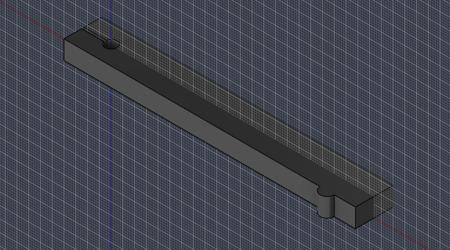

# Motorvermessung

Erster Schritt von Phase 2. Ziel: das Haltemoment der drei vorhandenen Motoren (17CS04A-170E) messen, weil kein Datenblatt auffindbar ist und die Lastrechnung von diesem Wert abhängt.

## Sofort möglich (ohne Druckteile)

| Messung | Wie | Erwartung |
|---|---|---|
| Gehäuselänge ohne Welle | Schieblehre oder Lineal | ca. 40 mm |
| Wicklungswiderstand | Multimeter zwischen den zwei Adern einer Wicklung (die Paare findest du per Durchgangsprüfung) | 1,5–2,5 Ω bei einem 1,7-A-Motor |

Liegt der Widerstand deutlich höher (z. B. 30 Ω), ist es ein Motor für kleinen Strom und die Annahme 1,7 A falsch.

## Haltemoment (braucht den gedruckten Messhebel)

Aufbau: Motor liegend festgeschraubt, Messhebel auf die Welle geklemmt, das Hebelende drückt in 100 mm Abstand von der Wellenmitte auf die Küchenwaage.

1. Motor am Uno + CNC-Shield mit A4988 an 12 V anschliessen, Strom am Treiber einstellen (Vref, wird mit dem Prüfstand dokumentiert).
2. Motor bestromen, ohne ihn zu drehen (GRBL: `$1=255`, dann eine kleine Bewegung senden, damit die Treiber aktiv bleiben).
3. Hebel waagrecht auf die Waage legen, Waage auf null stellen.
4. Motor in kleinen Schritten gegen die Waage fahren, bis er durchrutscht. Den höchsten Wert vor dem Durchrutschen notieren.
5. Dreimal wiederholen, bei allen drei Motoren.

Auswertung: Moment (Nm) = Anzeige (g) × 0,000981. Beispiel: 400 g am 100-mm-Hebel = 0,39 Nm.

Der neue 60-mm-Motor für J2 wird nach der Lieferung genauso gemessen.

**Wichtig für die Auswertung:** Den am Treiber eingestellten Spitzenstrom notieren. Im Mikroschrittbetrieb mit dem Nennstrom als Spitzenwert liegt der gemessene Wert schon bei etwa 70 % des Datenblatt-Haltemoments. Ein so gemessener Wert wird in der Lastrechnung **direkt** als nutzbares Moment eingesetzt, ohne noch einmal 70 % abzuziehen.

## Protokoll

| Motor | Länge (mm) | Widerstand (Ω) | Spitzenstrom (A) | Anzeige (g) | gemessenes Moment (Nm) |
|---|---|---|---|---|---|
| 1 | | | | | |
| 2 | | | | | |
| 3 | | | | | |
| J2 (60 mm) | | | | | |

Die Lastrechnung braucht für die vorhandenen Motoren 0,21 Nm nutzbares Moment, damit J3 mit 60:1 die Sicherheit 1,5 hält (angenommen sind 0,28 Nm). Liegt der Messwert darunter, wird J3 auf 70:1 erhöht (siehe `docs/lastrechnung.md`).

## Messhebel drucken

Datei: `cad/export/stl/Messhebel.stl` (124 × 19 × 8 mm). Flach auf das Druckbett legen, PLA, 4 Wände, 40 % Infill, keine Stützen.

- Die 5,1-mm-Bohrung kommt auf die Motorwelle; eine M3-Schraube mit Mutter quer durch das geschlitzte Ende klemmt den Hebel fest. Hat die Welle eine Abflachung, die Schraube so ausrichten, dass der Schlitz darüber liegt.
- Die runde Nocke sitzt genau 100 mm von der Wellenmitte entfernt und drückt auf die Waage.
