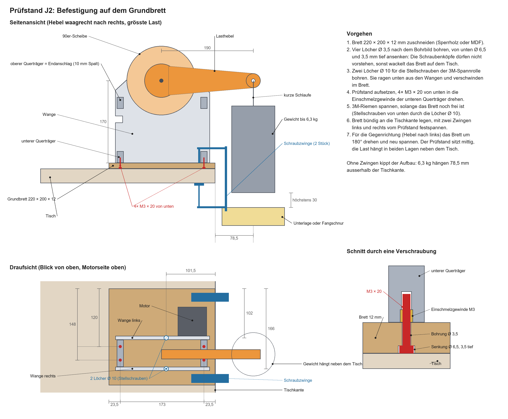

# Prüfstand Schultergelenk J2

Das Schultergelenk in Originalgrösse mit drei Riemenstufen (72:1). Der Prüfstand misst Umkehrspiel, Steifigkeit, Kriechen und Erwärmung, bevor der Arm konstruiert wird (Gate in `konzept.md`, Phase 2).

Das CAD entsteht aus dem Skript `cad/skripte/j2_pruefstand.py`. Alle Masse stehen dort oben als Konstanten; nach einer Änderung wird das Skript in Fusion neu ausgeführt und baut die Baugruppe `J2_Pruefstand` neu auf. Das Skript bricht ab, wenn eine Spannrolle den Riemen auf eine Scheibe drücken würde.

## Aufbau

Zwei Wangen (8 mm, 195 × 196 mm) mit 56 mm lichter Weite, verbunden durch vier Querträger und die beiden Spannrollen-Schrauben. Der Motor sitzt aussen an der linken Wange. Die drei Riemenstufen liegen in nur zwei Ebenen, weil Stufe 1 und Stufe 3 nebeneinander Platz haben:

| Ebene | Lage zwischen den Wangen | Inhalt |
|---|---|---|
| 1 (Motorseite) | 3,5–20 mm | Stufe 1 (GT2) und Stufe 3 (HTD-5M) |
| 2 | 20–46,5 mm | Stufe 2 (HTD-3M), Lasthebel und Messzeiger |

| Achse | Lage x / y (mm) | Darauf sitzt |
|---|---|---|
| Motor M | 63,9 / 83,7 | Ritzel GT2 20 Z |
| Welle A | 38,2 / 39,2 | Scheibe GT2 72 Z (gedruckt), Ritzel 3M 16 Z |
| Welle B | −19,4 / 60,2 | Scheibe 3M 64 Z (gedruckt), Ritzel 5M 18 Z |
| Abtrieb O | 0 / 170 | Scheibe 5M 90 Z (gedruckt), Lasthebel, Messzeiger |

Ursprung ist die Tischfläche unter der Abtriebsachse. Die Abtriebsachse liegt auf 170 mm, wie später die Schulter (`H_schulter`).

| Stufe | Riemen | Achsabstand (Nennmass) | Spannen | Zähne im Eingriff am Ritzel | Spannreserve |
|---|---|---|---|---|---|
| 1 | GT2 10 mm, 200 mm | 51,3 mm (51,3) | Motor in Langlöchern, ±3 mm | 7,9 | – |
| 2 | HTD-3M 15 mm, 252 mm | 61,3 mm (61,69) | Spannrolle (2× Lager 608) bei 10 / 23,2 | 6,5 | 2,9 mm Riemenlänge (nutzbar etwa 2,1 mm) |
| 3 | HTD-5M 15 mm, 525 mm | 111,5 mm (112,58) | Spannrolle Ø 32 mm (gedruckt, 2× Lager 608) bei −54,9 / 90 | 6,6 | 4,8 mm Riemenlänge |

Die Achsabstände der Stufen 2 und 3 sind etwas kürzer als das Nennmass; die Spannrolle auf dem Riemenrücken holt die Länge herein und vergrössert die Umschlingung am kleinen Ritzel. Die freien Trume neben den Rollen sind mindestens 21 mm (3M) und 34 mm (5M) lang. Am Ende des Spannwegs kommt die Hülse der 3M-Rolle dem GT2-Riemen bis auf 1 mm nahe; deshalb sind von der 3M-Reserve etwa 2,1 mm nutzbar.

**Spannrollen:** Jede Rolle läuft auf einer Schraube M8 × 90 (mit Schaft, Teilgewinde) in Langlöchern beider Wangen (±8 mm), mit Scheiben unter Kopf und Mutter. In jeder Wange stützt eine M3-Stellschraube die M8-Schraube gegen den Riemenzug ab: Damit wird gespannt, und sie hält die Lage. Die M8-Mutter (selbstsichernd) wird deshalb nur **handfest** angezogen, etwa 1 Nm – fester Anzug würde die gedruckten Hülsen zerdrücken.

- Die Stellschrauben der 5M-Rolle sitzen in einer Nische an der linken Kante der Wangen.
- Die Stellschrauben der 3M-Rolle kommen von unten und ragen im gespannten Zustand rund 9 mm aus den Wangen (ganz entspannt bis 17 mm – dann steht der Prüfstand noch nicht auf dem Brett). Das Grundbrett bekommt dafür zwei Löcher Ø 10 mm; gespannt wird, bevor das Brett am Tisch festgezwungen ist (siehe Skizze unten).

## Wie das Drehmoment übertragen wird

- **Abtrieb:** Der Lasthebel ist mit 6× M3 × 16 direkt auf die 90er-Scheibe geschraubt. Die Welle trägt kein Drehmoment. Die Bohrungen von Scheibe und Hebel sind stramm (8,05 mm), weil Radialspiel hier in die Messung einginge.
- **Welle B (2,4 Nm dauernd, 4,2 Nm Spitze):** Die 64er-Scheibe hat eine Hülse, die über die Nabe des gekauften 18er-Ritzels greift. Die beiden Gewindestifte des Ritzels werden durch Schrauben M4 × 16 ersetzt. Sie gehen saugend durch die Bohrungen der Hülse (gedruckt mit 3,9 mm, aufbohren, bis die Schraube ohne Spiel durchgeht – kein Gewinde im Kunststoff), laufen durch die Gewinde der Ritzelnabe und drücken auf die angefeilte Welle. So ist das Ritzel auf der Welle fest, und die Scheibe nimmt das Ritzel formschlüssig mit. Die Schraubenköpfe liegen nicht auf.
- **Welle A (0,6 Nm):** Die 72er-Scheibe sitzt mit zwei Schrauben M3 × 10 (in Einschmelzgewinden der Nabe) auf einer angefeilten Fläche der Welle; das 16er-Ritzel mit seinen eigenen Gewindestiften.

## Messen

- **Messzeiger:** Ein eigener, unbelasteter Zeiger ist auf die 90er-Scheibe geschraubt und zeigt dem Hebel entgegen. Gemessen wird nur dort, nicht am Lasthebel: Der Hebel biegt sich unter 6 kg selbst um etwa so viel, wie der Antrieb nachgibt. Am Ende trägt der Zeiger einen Tastklotz mit zwei ebenen Flächen.
- **Messuhrhalter:** Er wird aussen an die rechte Wange geschraubt und klemmt die Messuhr (Schaft 8 mm) in einer geschlitzten Bohrung (Schraube M3 × 25 nur leicht anziehen) senkrecht über dem Tastklotz, 64 mm von der Achse. 0,1° entsprechen dort 0,11 mm. Die Messuhr ist am Rahmen abgestützt, nicht am Tisch. Ihre Achse liegt 38 mm neben der linken Wange, sodass das Gehäuse neben der 90er-Scheibe und dem Riemen Platz hat. Von der Unterkante des Halters bis zur Tastfläche sind es 15 mm.
- Der Halter passt in zwei Lagen: links für «Hebel waagrecht nach rechts», rechts für «Hebel waagrecht nach links». Er steht im Schwenkbereich des Hebels (der Hebel trifft ihn 25° neben der Senkrechten) und wird für grosse Bewegungen abgenommen.
- **Blockierstift:** Eine Schraube M3 × 25 geht durch eine von vier Bohrungen der 72er-Scheibe in die linke Wange (Zugang durch eine Bohrung in der rechten Wange, am besten mit Kugelkopf- oder magnetischem Schlüssel). Sie wird nur angelegt, nicht festgezogen: Fester Anzug würde die Scheibe schief gegen das Lager ziehen. Das Restspiel der Bohrung geht mit höchstens 0,017° am Abtrieb in die Messung ein. Damit sind Motor und Stufe 1 von der Messung getrennt, und es werden nur die Stufen 2 und 3 gemessen. Die Scheibe lässt sich so alle 4,5° am Abtrieb festsetzen.

**Umkehrspiel unter Wechsellast ±2 Nm** (die Messuhr bleibt dabei stehen, das Gewicht von 1,07 kg bleibt hängen):

1. Hebel knapp über der Waagrechten, Blockierstift gesetzt (oder Motor bestromt), Messuhr auf dem Tastklotz.
2. Mit einer Koffer- oder Federwaage an der Lastbohrung senkrecht nach oben ziehen, bis sie 1,07 kg zeigt: Moment null, von unten kommend. Ablesen (Wert 1).
3. Weiter ziehen bis 2,15 kg: +2 Nm. Ablesen (Wert 2).
4. Nachlassen auf 1,07 kg: Moment null, von oben kommend. Ablesen (Wert 3).
5. Waage ganz lösen: −2 Nm. Ablesen (Wert 4).

Das **Umkehrspiel** (einschliesslich Reibung) ist der Unterschied zwischen Wert 1 und Wert 3, beide bei Moment null. Die **Steifigkeit** folgt aus Wert 2 und Wert 4: 4 Nm geteilt durch den Winkel zwischen beiden, abzüglich des Umkehrspiels. Das Eigengewicht des Hebels (grob 0,1–0,15 Nm) verschiebt den Nullpunkt; einmal ohne Gewicht mit der Waage bestimmen, bei welcher Anzeige der Hebel schwebt, und diesen Wert zu den Anzeigen oben addieren.

**Steifigkeit und Haltetest unter voller Last:** Gewicht anhängen, Ausschlag am Tastklotz ablesen. Die Messuhr sieht dabei auch, wenn sich die Abtriebswelle im Lagersitz setzt. Trennen lässt sich das nur mit einer zweiten Messung direkt auf dem Nabenbund des Hebels (Ø 22 mm, neben der rechten Wange); dafür reicht der Messuhrhalter nicht, es braucht ein Stativ auf dem Grundbrett. Ohne Stativ bleibt dieser Anteil als Unsicherheit im Ergebnis (0,05 mm Setzen wären 0,045°).

**Rücklauftest (ohne Strom):** Hebel waagrecht, Gewicht 1,07 kg (2 Nm), Fangschnur gesetzt, Messuhr abgenommen. Motor stromlos schalten und beobachten: Bleibt der Hebel stehen, sinkt er langsam (Zeit bis zum Anschlag stoppen) oder fällt er? Dann mit 5,9 kg (11 Nm) wiederholen. Das Ergebnis entscheidet mit, ob der Arm eine Ausgleichsfeder braucht (`docs/konzept.md`, 3.8).

## Lasthebel und Sicherheit

Länge 190 mm von der Achse bis zur Lastbohrung (Ø 8 mm), 20 mm dick, von 60 mm an der Nabe auf 30 mm verjüngt.

| Prüfung | Gewicht an der Lastbohrung |
|---|---|
| Wechsellast ±2 Nm | 1,07 kg |
| Haltetest 11 Nm | 5,9 kg |
| Volles Gelenkmoment 11,8 Nm | 6,3 kg |

- **Endanschläge:** Die beiden oberen Querträger fangen den Hebel ab. Bei waagrechtem Hebel bleiben rund 10 mm Spalt über dem Querträger; die Lastbohrung kann noch 22 mm sinken, bis der Hebel aufliegt (Anschlag bei 96,7° aus der Senkrechten). Unter voller Last gibt der Antrieb voraussichtlich so weit nach, dass die Lastbohrung 0,3–1,3 mm sinkt (am Querträger 0,15–0,6 mm) – der Anschlag wird nicht erreicht. Vor jeder Ablesung wird trotzdem geprüft, dass der Spalt offen ist: Liegt der Hebel auf, ist die Messung ungültig.
- **Aufstellung:** Der Prüfstand wird mit vier Schrauben M3 × 20 von unten auf ein Brett (220 × 200 × 12 mm) geschraubt; die Schraubenköpfe sind 3,5 mm versenkt. Das Brett liegt bündig an der Tischkante, die Wangen stehen quer zur Kante, und zwei Schraubzwingen halten es links und rechts vom Prüfstand. Ohne Zwingen kippt der Aufbau, weil die Last 78,5 mm ausserhalb der Tischkante hängt. Für die Gegenrichtung wird das Brett um 180° gedreht und neu gespannt; der Prüfstand sitzt mittig auf dem Brett, die Last hängt in beiden Lagen neben dem Tisch.

- **Fallende Last:** Der Antrieb ist rückdrehbar. Ohne Motorstrom oder bei Schrittverlust fällt der Hebel bis zum Anschlag. Deshalb: Gewicht an einer kurzen Schlaufe, höchstens 30 mm über einer weichen Unterlage oder mit Fangschnur; Hände nicht unter dem Hebel.

## Teile

Die vollständige Stückliste mit Positionsnummern, Elektrik, Messmitteln, Werkzeug und Verbrauchsmaterial steht in [stuecklisten/pruefstand-j2.md](stuecklisten/pruefstand-j2.md).

**Gedruckt** (Volumen als Vollkörper):

| Teil | Menge | Material | cm³ | Drucklage |
|---|---|---|---|---|
| Wange links (Motorseite) | 1 | PETG | 267 | flach |
| Wange rechts | 1 | PLA | 268 | flach |
| Querträger | 4 | PLA | je 18 | liegend |
| Scheibe GT2 72 Z | 1 | Prüfstand entscheidet (Start: PETG) | 21 | Zahnkranz unten, Nabe oben |
| Scheibe 3M 64 Z | 1 | wie oben | 49 | Zahnkranz unten, Hülse oben |
| Scheibe 5M 90 Z | 1 | wie oben | 207 | Hebelseite unten |
| Lasthebel | 1 | PLA | 223 | flach, Nabenbund oben |
| Messzeiger | 1 | PLA | 15 | flach, Tastklotz oben |
| Messuhrhalter | 1 | PLA | 34 | auf dem Rücken |
| Spannrolle 5M | 1 | PETG | 7 | stehend |
| Distanzringe und -hülsen | 9 | PETG | zusammen 10 | stehend |

Die linke Wange und die Hülsen sind aus PETG, weil der Motor im Haltetest dauernd bestromt direkt auf der Wange sitzt und die Hülsen unter Klemmkraft stehen. Grösstes Teil ist der Lasthebel mit 240 mm.

**Gekauft:**

| Teil | Menge |
|---|---|
| Ritzel GT2 20 Z, Bohrung 5 mm, für 10-mm-Riemen | 1 |
| Ritzel HTD-3M 16 Z, Bohrung 8 mm, für 15-mm-Riemen, mit Bordscheiben | 1 |
| Ritzel HTD-5M 18 Z, Bohrung 8 mm, für 15-mm-Riemen, mit Bordscheiben und Nabe | 1 |
| Riemen GT2 200 mm (10 mm), HTD-3M 252 mm (15 mm), HTD-5M 525 mm (15 mm) | je 1 |
| Rillenkugellager 608 | 10 |
| Stahlwelle 8 mm, 70 mm lang | 3 |
| Sechskantschraube M8 × 90 mit Schaft (Teilgewinde), selbstsichernder Mutter und 2 Scheiben | 2 |
| Einschmelzgewinde M3 | 41 |
| Schrauben M3 × 8 | 1 |
| Schrauben M3 × 10 | 2 |
| Schrauben M3 × 12 | 4 |
| Schrauben M3 × 16 | 26 |
| Schrauben M3 × 20 | 4 |
| Schrauben M3 × 25 | 4 |
| Schrauben M3 × 30 | 2 |
| Schrauben M4 × 16 (Gewinde am Ritzel prüfen: M4 oder M5) | 2 |
| Brett 220 × 200 × 12 mm, 2 Schraubzwingen | 1 |
| Koffer- oder Federwaage bis mindestens 10 kg (Wechsellast, Gewichte abwiegen) | 1 |

Wofür welche M3-Schraube: × 8 Hebelnabe · × 10 Gewindestifte der 72er-Scheibe · × 12 Motor (4) · × 16 Querträger (16), Hebel (6), Messzeiger (2), Messuhrhalter (2) · × 20 Grundbrett · × 25 Blockierstift (1), Stellschrauben der 3M-Rolle (2), Klemmung der Messuhr (1) · × 30 Stellschrauben der 5M-Rolle.

## Reihenfolge

1. **Ritzel und Riemen bestellen und die Ritzel nachmessen**, bevor die Scheiben gedruckt werden (siehe Annahmen).
2. Toleranz-Testdruck: Lagersitz, Einschmelzgewinde (auch eines in der 8-mm-Kante wie bei den Stellschrauben), Nabenbohrungen, dazu je ein Zahnsegment der drei Profile mit dem Riemen prüfen.
3. Wellen ablängen und anfeilen, Einschmelzgewinde setzen.
4. Linke Wange flach hinlegen, Motor mit seinen vier Schrauben lose anschrauben (zwei davon liegen später dicht neben dem GT2-Riemen und lassen sich dann nicht mehr einsetzen, nur noch anziehen). Lager einsetzen, die Wellen mit Scheiben, Ritzeln und aufgelegten Riemen stecken, Spannrollen und Querträger setzen, rechte Wange aufsetzen und verschrauben.
5. Auf das Grundbrett schrauben. Spannen in der Reihenfolge Stufe 3, Stufe 2 (Stellschrauben, dann M8-Mutter handfest), Stufe 1 (Motorschrauben durch die Langlöcher der rechten Wange). Erst danach das Brett am Tisch festzwingen.

## Annahmen, die am gelieferten Teil nachzumessen sind

- **Ritzel 5M 18 Z:** Nabe Ø 20 × 8 mm mit zwei Gewindestiften M4 im Winkel von 90°, Mitte 3,75 mm vom Nabenende. Die Hülse der 64er-Scheibe ist darauf ausgelegt und wird sonst angepasst (Nabenlänge, Gewinde M4 oder M5, Lage der Stifte).
- **Ritzel 3M 16 Z:** Gesamtlänge 24,5 mm (Zahnbreite 16,5 mm, zwei Bordscheiben, Nabe 6 mm). Fehlt die Nabe, sitzen die Gewindestifte im Zahnbereich; dann wird nur der Distanzring angepasst.
- **Zahnform der gedruckten Scheiben:** vereinfachte U-Lücke (GT2: Radius 0,65 / Tiefe 0,80 mm; 3M: 0,95 / 1,27; 5M: 1,60 / 2,16), ohne Kantenradius am Kopfkreis. Flankenspiel an der 90er-Scheibe wirkt direkt (0,2 mm sind 0,16°), deshalb das Zahnsegment vorab drucken und den Lückenradius einstellen.
- **Drucktoleranzen:** Lagersitz Ø 22,20 mm (gemessen im Toleranz-Testdruck 18.10.), Bohrung für Einschmelzgewinde Ø 4,0 mm (gemessen 20.10. mit Lötkolben), Nabenbohrungen Ø 8,15 mm (Wellen A, B) und 8,05 mm (Abtrieb), Mitnahmebohrung Ø 3,9 mm – die Wellen- und Mitnahmebohrungen sind noch Startwerte bis zur Auswertung von Reihe B und des M3-Durchgangs.
- **Motor:** Gewindetiefe der M3-Befestigung messen (M3 × 12 greift 4 mm ein).
- **Messuhr:** Schaft Ø 8 mm; vom Schaftende bis zur Tastspitze müssen mindestens 15 mm erreichbar sein. Das Gehäuse darf von der Schaftachse aus höchstens 17 mm zur rechten Wange und 17 mm zur Scheibe hin auftragen (übliche Messuhren 0–10 mm sind etwa 25 mm dick).

## Bewusst so belassen

- Der Lagerbund in den Wangen ist 1 mm stark. Riementriebe bringen keine nennenswerte Axialkraft auf die Lager.
- Die 3M-Spannrolle besteht aus zwei blanken Lagern (14 mm breit, Riemen 15 mm) ohne Bord; der Riemen wird vom Bordritzel geführt.

## Prüfung im CAD

Kollisionsprüfung über alle 44 Körper: keine Durchdringung. Exporte: `cad/export/stl/J2_Pruefstand/` (22 Druckteile) und `cad/export/step/J2_Pruefstand.step`. Kleinste Abstände: Messzeiger zur Hebelnabe 2,0 mm, Hülse der 3M-Rolle zum GT2-Riemen 2,8 mm, Messuhrhalter zum 5M-Riemen 4,8 mm, 3M-Rolle zur 64er-Scheibe 6,1 mm, Messzeiger im Schwenk zur 64er-Scheibe mit Riemen 6,5 mm, 5M-Rolle zur 90er-Scheibe 10 mm.
