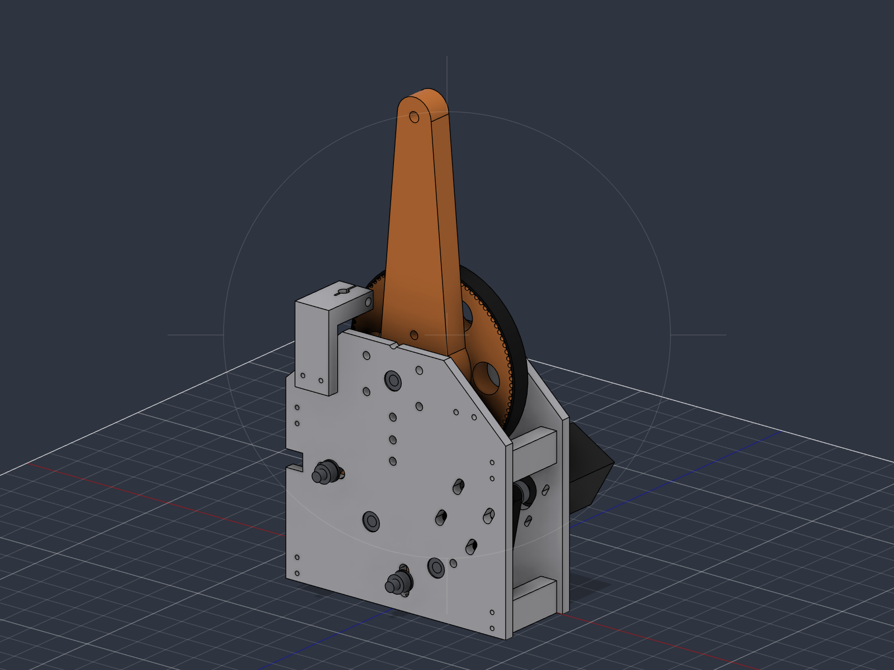
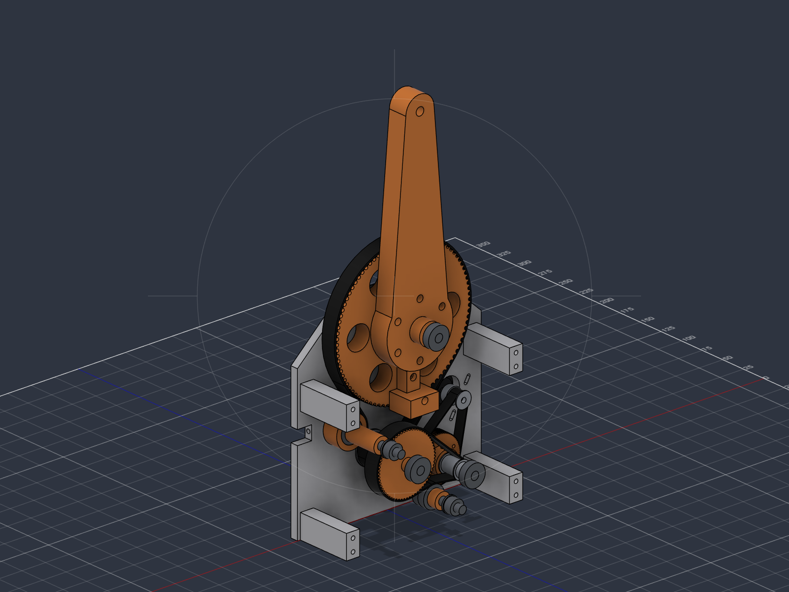
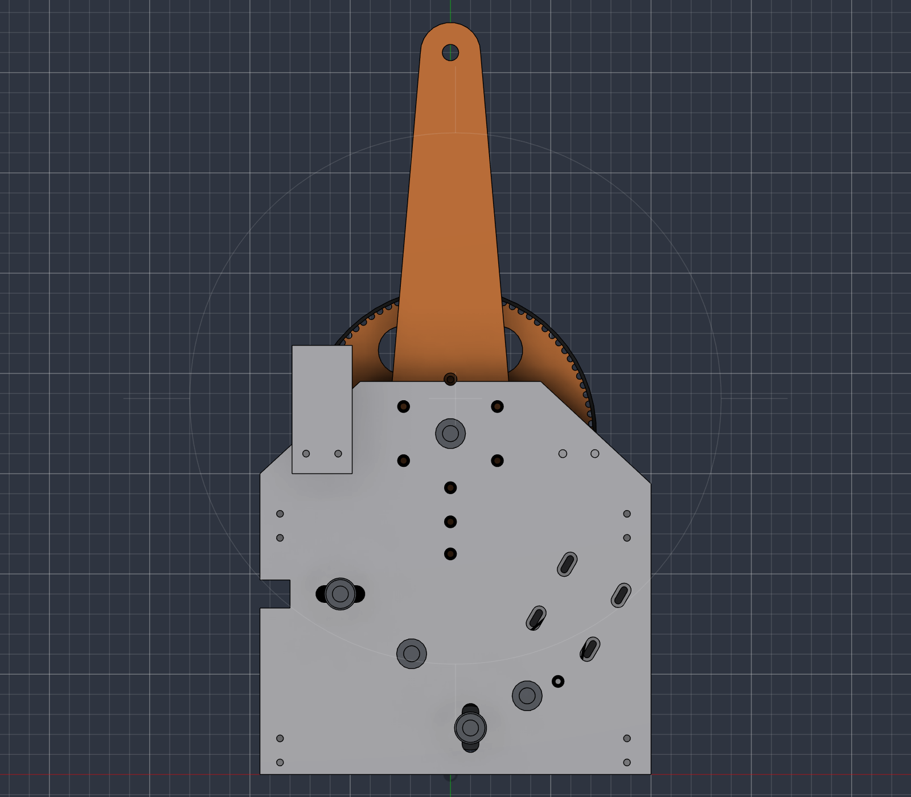
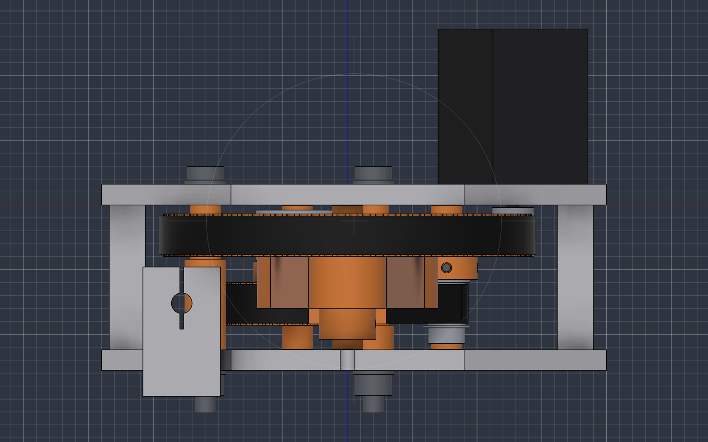

Ein selbst konstruierter 6-Achs-Desktop-Roboterarm: 3D-gedruckt (PLA/PETG, BambuLab A1), NEMA-17-Schrittmotoren, alle Achsen über Zahnriemen, Standardteile von AliExpress. Später kommen eine Schiene als siebte Achse, Kamera-KI und ein automatischer Greiferwechsel dazu.

| | |
|---|---|
| Achsen | 6 (Knickarm mit Zentralhand) + Schiene als 7. Achse |
| Reichweite | 450 mm (Schulter → Flansch) |
| Nutzlast | 1 kg im ganzen Arbeitsraum |
| Wiederholgenauigkeit (Ziel) | ≤ ±0,5 mm |
| Steuerung | BTT Octopus + grblHAL, 7 synchrone Achsen, TMC2209, 24 V |
| Software | Python auf dem PC (Kinematik, Bahnplanung, später Kamera/KI) |

## Stand: 14. Oktober 2026

Das Konzept steht und ist begutachtet. Als Erstes werden die vorhandenen Motoren vermessen, denn die Lastrechnung hängt von ihrem Moment ab. Dafür gibt es einen Motorprüfstand, der ganz ohne Kaufteile auskommt (Gutachten 8/10). Danach wird das Schultergelenk J2 als Prüfstand gebaut, weil dort das grösste Risiko liegt: Drei Riemenstufen (72:1) müssen 11,8 Nm übertragen, ohne zu viel Spiel und Nachgiebigkeit. Dessen CAD ist fertig und begutachtet (8/10).

| Phase | Inhalt | Stand |
|---|---|---|
| 0 | Projektgerüst | fertig |
| 1 | Detailkonzept, Kinematik, Lastrechnung | fertig, Gutachten 8/10 |
| 2 | Motorvermessung | Motorprüfstand fertig, Gutachten 8/10 – drucken, messen |
| 2 | Prüfstand Schultergelenk J2 | CAD fertig, Gutachten 8/10 – Teile bestellen, drucken, messen |
| 2b | Machbarkeitstest Steuerung (7 Achsen) | offen |
| 3–4 | CAD und Bau Basis, Schulter, Oberarm | offen |
| 5 | Hand, Flansch, Greifer | offen |
| 6–9 | Verkleidung, Elektronik, Software, Dokumentation | offen |
| 10 | Schiene (7. Achse) | offen |

## Motorprüfstand

Ein gedruckter Halter für einen NEMA 17. Gemessen wird mit einer Wasserflasche an der Schnur und der Küchenwaage: Haltemoment am Waagebalken (100 mm), Moment bei Drehzahl mit einer Seiltrommel (Radius 20 und 10 mm) und Schrittverlust unter Last.

| | |
|---|---|
|  |  |
| Halter, Motor und Waagebalken | Aufstellung an der Tischkante, Test A |

[Bauanleitung (PDF)](docs/bauanleitung/Bauanleitung_Motorpruefstand.pdf) · [Messungen](docs/motorvermessung.md) · [Stückliste](docs/stuecklisten/motorpruefstand.md)

## Prüfstand Schultergelenk J2

Der Prüfstand ist das spätere Schultergelenk in Originalgrösse. Er misst Umkehrspiel, Steifigkeit, Kriechen und Erwärmung des Antriebs, bevor der Arm konstruiert wird.

Vom Motor (rechts) geht es über einen GT2-Riemen auf die erste Zwischenwelle, von dort über einen HTD-3M-Riemen auf die zweite und über einen HTD-5M-Riemen auf die grosse 90er-Scheibe am Abtrieb. Die Stufen 1 und 3 liegen in derselben Ebene, deshalb ist das Gelenk nur 56 mm breit. Zwei Spannrollen drücken von aussen auf die Riemenrücken.

| | |
|---|---|
|  |  |
| Zusammengebaut, mit Messuhrhalter | Ohne rechte Wange |
|  |  |
| Von rechts: Zugangsbohrungen für die Schrauben | Von oben: zwei Riemenebenen, Motor aussen |

Für die Messung wird der Prüfstand auf ein Brett geschraubt und an der Tischkante festgezwungen. Am Hebel hängen bis zu 6,3 kg:

Mehr dazu: [Beschreibung des Prüfstands](docs/pruefstand-j2.md) mit Teileliste, Montagefolge und Messablauf.

## Unterlagen

- [Konzept und Projektplan](docs/konzept.md)
- [Anforderungen](docs/anforderungen.md) und [Parameterliste](docs/parameter.md)
- [Lastrechnung](docs/lastrechnung.md)
- [Stückliste der Kaufteile](docs/bom.md)
- [Prüfstand Schultergelenk J2](docs/pruefstand-j2.md) mit [vollständiger Stückliste](docs/stuecklisten/pruefstand-j2.md)
- [Motorvermessung](docs/motorvermessung.md) mit [Bauanleitung des Motorprüfstands (PDF)](docs/bauanleitung/Bauanleitung_Motorpruefstand.pdf) und [Stückliste](docs/stuecklisten/motorpruefstand.md)
- [Verdrahtung](docs/verdrahtung.md)

**Gutachten.** Jede Idee und jede Baugruppe wird von einem unabhängigen Gutachter mit 1–10 bewertet, höchstens drei Runden:

- [Gesamtkonzept](docs/reviews/2026-10-11-konzept.md) · [Detailkonzept](docs/reviews/2026-10-11-detailkonzept.md)
- [Antrieb von Schulter und Ellbogen](docs/reviews/2026-10-11-antrieb-j2-j3.md) · [Steuerung für 7 Achsen](docs/reviews/2026-10-11-steuerung-7-achsen.md)
- [CAD des J2-Prüfstands](docs/reviews/2026-10-12-pruefstand-j2.md) · [Motorprüfstand](docs/reviews/2026-10-14-motorpruefstand.md)

**Dateien zum Nachbauen.** Die Druckteile des Prüfstands liegen als STL unter `cad/export/stl/J2_Pruefstand/`, die Baugruppe als STEP unter `cad/export/step/`. Die Geometrie entsteht aus dem Skript `cad/skripte/j2_pruefstand.py`, das die Baugruppe in Fusion 360 aufbaut. Die Teile des Motorprüfstands liegen unter `cad/export/stl/Motorpruefstand/`, erzeugt von `cad/skripte/motorpruefstand.py`.
