Ein selbst konstruierter 6-Achs-Desktop-Roboterarm: 3D-gedruckt (PLA/PETG, BambuLab A1), NEMA-17-Schrittmotoren, alle Achsen über Zahnriemen, Standardteile von AliExpress. Später kommen eine Schiene als siebte Achse, Kamera-KI und ein automatischer Greiferwechsel dazu.

| | |
|---|---|
| Achsen | 6 (Knickarm mit Zentralhand) + Schiene als 7. Achse |
| Reichweite | 450 mm (Schulter → Flansch) |
| Nutzlast | 1 kg im ganzen Arbeitsraum |
| Wiederholgenauigkeit (Ziel) | ≤ ±0,5 mm |
| Steuerung | BTT Octopus + grblHAL, 7 synchrone Achsen, TMC2209, 24 V |
| Software | Python auf dem PC (Kinematik, Bahnplanung, später Kamera/KI) |

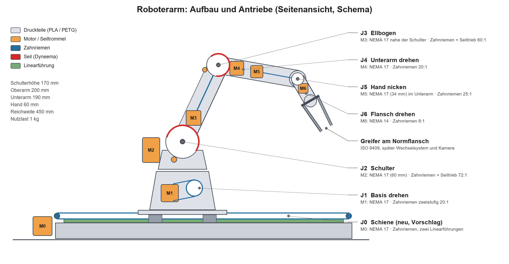

## Stand: 26. November 2026 (abends)

**Neu:** Das Aussehen des Arms ist festgelegt (Low-Poly-Schalen im Stil des Arctos-Arms, eigenes Design), und die erste Baugruppe ist fertig konstruiert: die **Basis mit J1**. Sie hat einen festen Hohlzapfen für die Kabel, zwei vorgespannte Dünnringlager, zwei Riemenstufen (20:1), einen Endschalter mit Halbmond-Nocken und einen festen Anschlag bei ±173°. Im CAD wurden jeder Montageschritt, die Drehung über ±170° und der Werkzeugzugang zu jeder Schraube geprüft. Gutachten nach drei Runden plus Nachprüfung: 8/10. Für J2 wird die letzte Riemenscheibe kleiner (Ø 115 statt 143, dafür 25 mm breiter Riemen), damit die Schulter schlanker wird.

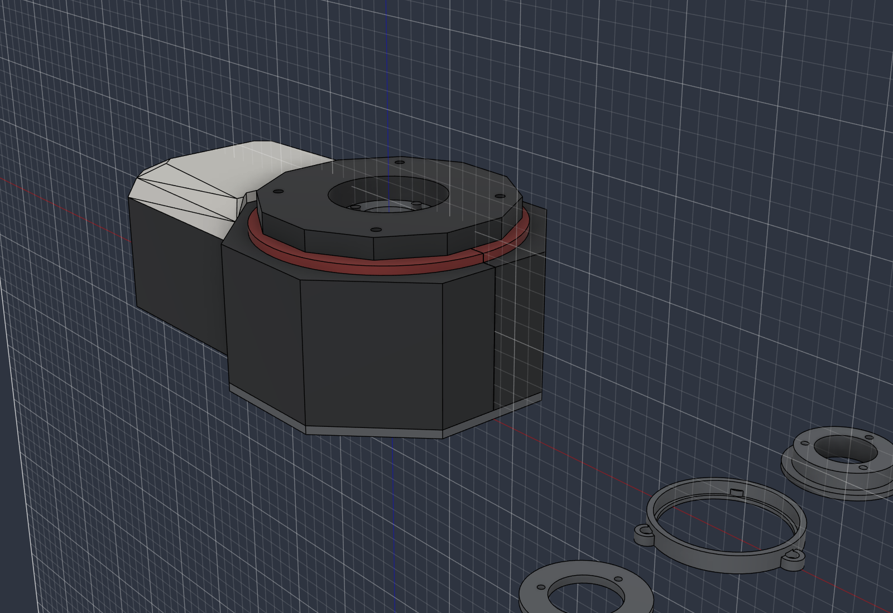
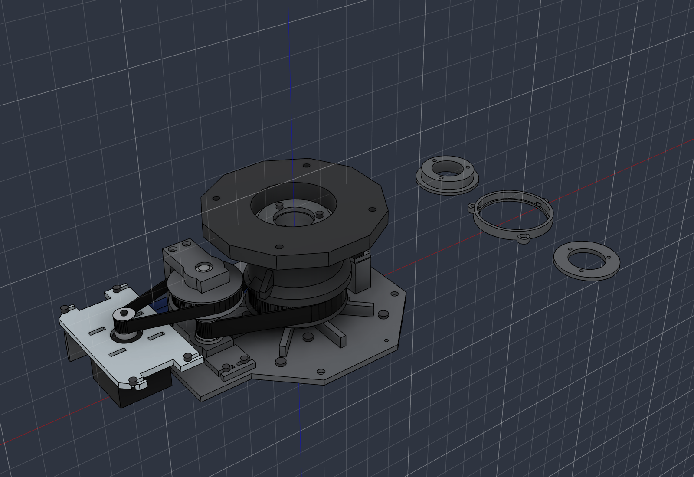

### Stand: 25. November 2026

Die Messphase am J2-Prüfstand ist durch (24 V, ESP32 mit FluidNC). Mit echten Gewichten (3,56 kg und 6,13 kg) liegt die Steifigkeit bei **ca. 17 bis 18 Nm/°** (Ziel 30, nicht erreicht; nach einer Stunde Dauerlast ca. 15 Nm/°). Das Umkehrspiel ist klein (unter 0,01° im ersten Test, 0,125° beim Rütteln von Hand). Das Kriechen unter 11,4 Nm ist in einer Stunde vernachlässigbar (0,06°), der Motor blieb kalt, Riemen und Scheiben zeigten keine Schäden. **Rücklauftest ohne Strom:** Der Hebel hält bei 1,9 Nm, fällt aber bei 6,6 Nm und 11,4 Nm in unter einer Sekunde. Darum kommen für den Arm drei Massnahmen in Frage: eine Parkposition (Abschalten nur in Ruhestellung), eine Haltebremse an J2 und J3 und eine Dämpfung am Anschlag. Die Genauigkeit soll zuerst per Software-Ausgleich und Kamera erreicht werden, nicht durch teurere Motoren. Stand 26. November: Das Datenblatt der vorhandenen Motoren (0,42 Nm, 1,7 A) ist gefunden und die Lastrechnung damit neu gerechnet (J3 mit 70:1 hat genug Reserve). Die Steuerung wird für den BTT Octopus geplant, die Basis wird austauschbar gebaut (die 7. Achse kommt später), und ein Kabelkonzept mit steckbaren, unverwechselbaren Kabelbäumen ist die Grundlage für die Konstruktion von unten nach oben.

Frühere Planung (4. November): Das Konzept steht und ist begutachtet. Als Erstes werden die vorhandenen Motoren vermessen, denn die Lastrechnung hängt von ihrem Moment ab. Dafür gibt es einen Motorprüfstand, der ganz ohne Kaufteile auskommt (Gutachten 8/10). Danach wird das Schultergelenk J2 als Prüfstand gebaut, weil dort das grösste Risiko liegt: Drei Riemenstufen (72:1) müssen 11,8 Nm übertragen, ohne zu viel Spiel und Nachgiebigkeit. Dessen CAD ist fertig und begutachtet (8/10).

| Phase | Inhalt | Stand |
|---|---|---|
| 0 | Projektgerüst | fertig |
| 1 | Detailkonzept, Kinematik, Lastrechnung | fertig, Gutachten 8/10 |
| 2 | Motorvermessung | Motorprüfstand fertig, Gutachten 8/10 – drucken, messen |
| 2 | Prüfstand Schultergelenk J2 | CAD fertig, Gutachten 8/10 – aufgebaut, Messphase durch (Spiel klein, Steifigkeit ca. 17 Nm/°, Kriechen unkritisch, fällt ohne Strom bei Last) – Entscheid Feder/Bremse/Parkposition offen |
| 2 | Elektronikgehäuse J2 (Netzteil, Arduino, C14, Sicherung, Klemmenabdeckung) | Entwurf, Gutachten 7/10 – Passproben drucken, Masse an den Teilen prüfen, Freigabe 230-V-Seite durch Elektriker |
| 2 | Steuerung J2: GRBL-Einstellungen, Testprogramme, Messprotokoll mit Auswertung | Weblösung `software/j2_steuerung.html` (ESP32/FluidNC und Uno/Grbl) am Gerät getestet; Messanleitung mit Bildern und Rechner in `docs/messung-anleitung.html` |
| 2 | Toleranztest und Standardteile (Endschalter-Halter, Kabelhalter, Not-Aus-Gehäuse) | CAD fertig, STL exportiert – drucken, Passungen messen |
| 2 | Zubehör J2 (Referenzschalter im Querträger mit Probe, Motorkabelklemme) | Entwurf, Gutachten 8/10 (Runde 3) – Schalter kaufen, Probe drucken und messen |
| 2b | Machbarkeitstest Steuerung (7 Achsen) | offen |
| 3–4 | CAD und Bau Basis, Schulter, Oberarm | offen |
| 5 | Hand, Flansch, Greifer (Vorbereitung: Greiferwechsler und Kamerahalter am Werkzeugflansch) | Entwurf, Gutachten 8/10 (Runde 3) – Magnetprobe zuerst; Hand selbst offen |
| 6–9 | Verkleidung, Elektronik, Software, Dokumentation | offen |
| 10 | Schiene (7. Achse); Vorbereitung: Kettenklemme für die Schleppkette | Entwurf, Gutachten 7/10 (Runde 3) – Bau erst in Stufe C |

## Motorprüfstand

Ein gedruckter Halter für einen NEMA 17. Gemessen wird mit einer Wasserflasche an der Schnur und der Küchenwaage: Haltemoment am Waagebalken (100 mm), Moment bei Drehzahl mit einer Seiltrommel (Radius 20 und 10 mm) und Schrittverlust unter Last.

| | |
|---|---|
| 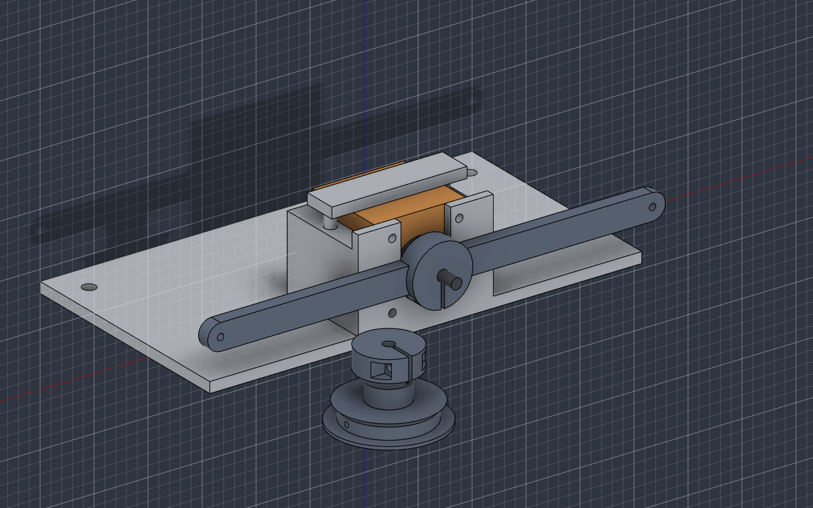 | 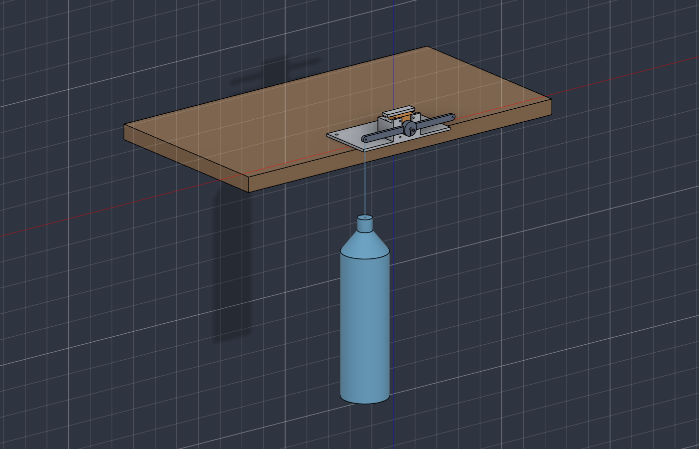 |
| Halter, Motor und Waagebalken | Aufstellung an der Tischkante, Test A |

[Bauanleitung (PDF)](docs/bauanleitung/Bauanleitung_Motorpruefstand.pdf) · [Messungen](docs/motorvermessung.md) · [Stückliste](docs/stuecklisten/motorpruefstand.md)

## Prüfstand Schultergelenk J2

Der Prüfstand ist das spätere Schultergelenk in Originalgrösse. Er misst Umkehrspiel, Steifigkeit, Kriechen und Erwärmung des Antriebs, bevor der Arm konstruiert wird.

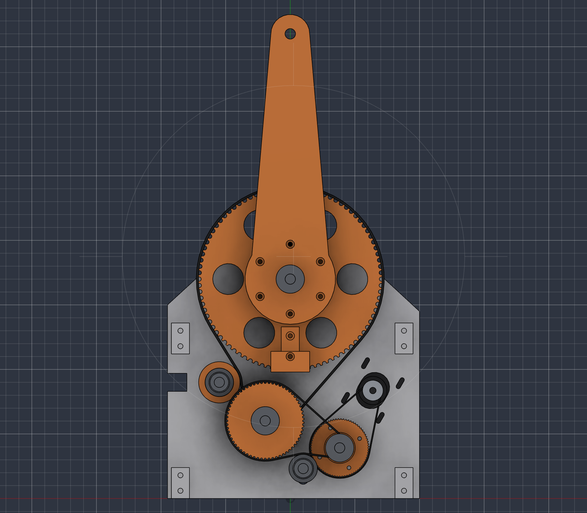

Vom Motor (rechts) geht es über einen GT2-Riemen auf die erste Zwischenwelle, von dort über einen HTD-3M-Riemen auf die zweite und über einen HTD-5M-Riemen auf die grosse 90er-Scheibe am Abtrieb. Die Stufen 1 und 3 liegen in derselben Ebene, deshalb ist das Gelenk nur 56 mm breit. Zwei Spannrollen drücken von aussen auf die Riemenrücken.

| | |
|---|---|
| 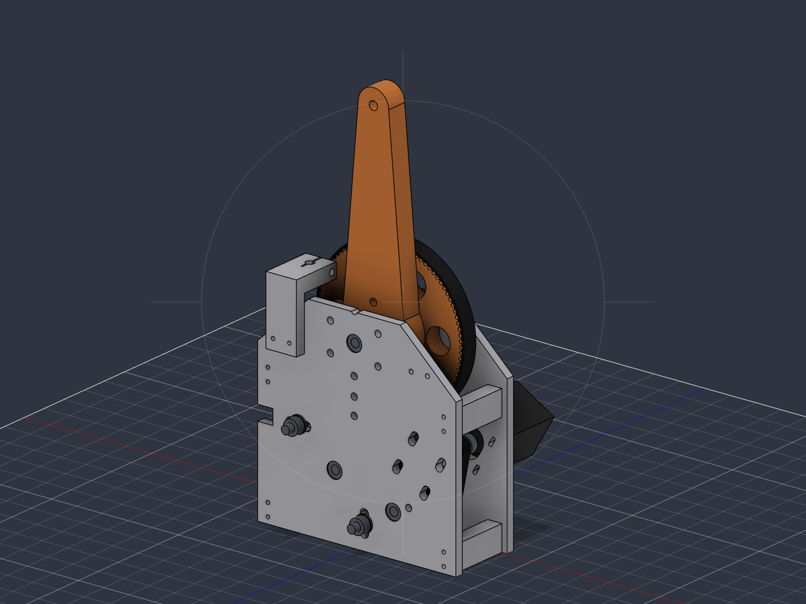 | 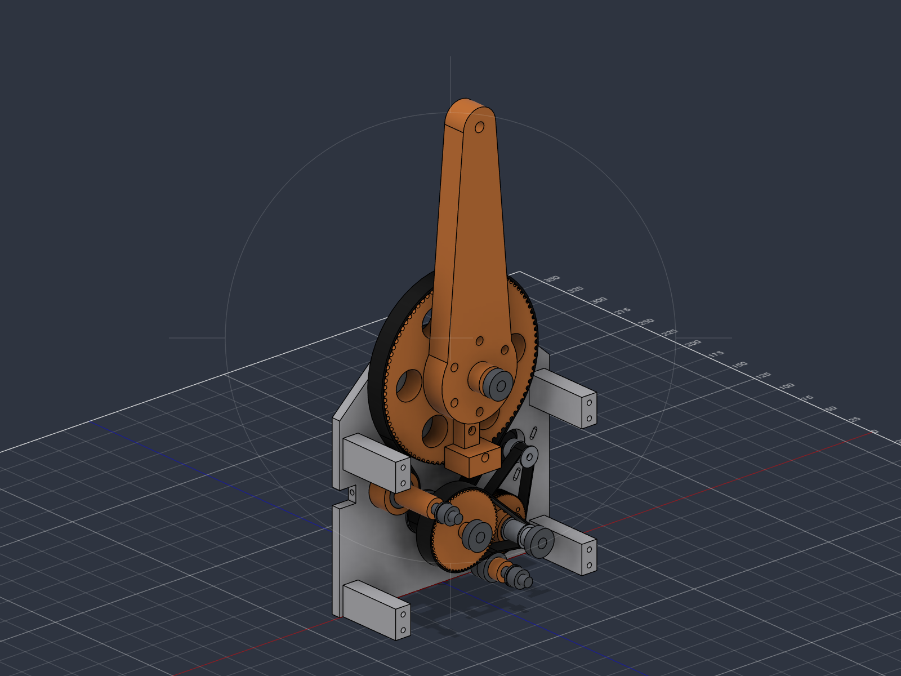 |
| Zusammengebaut, mit Messuhrhalter | Ohne rechte Wange |
| 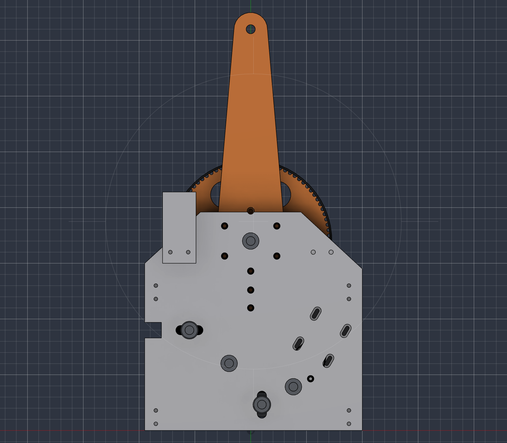 | 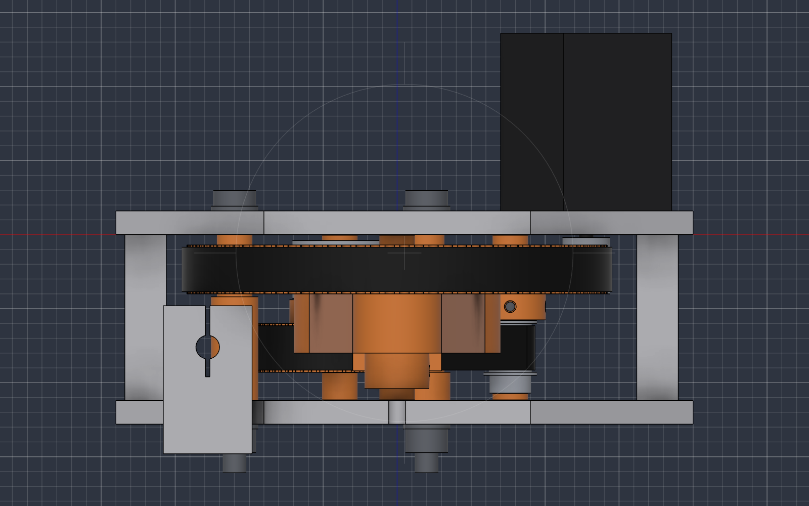 |
| Von rechts: Zugangsbohrungen für die Schrauben | Von oben: zwei Riemenebenen, Motor aussen |

Für die Messung wird der Prüfstand auf ein Brett geschraubt und an der Tischkante festgezwungen. Am Hebel hängen bis zu 6,3 kg:

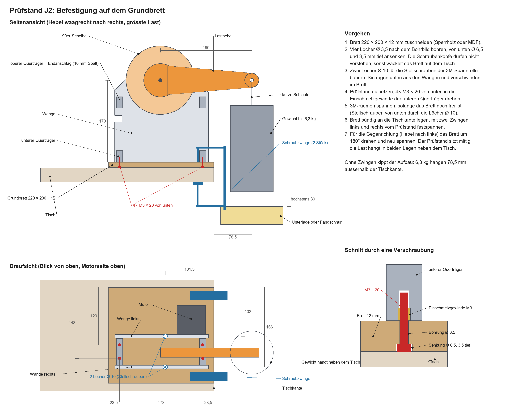

Mehr dazu: [Bauanleitung (PDF)](docs/bauanleitung/Bauanleitung_J2_Pruefstand.pdf) · [Beschreibung des Prüfstands](docs/pruefstand-j2.md) mit Teileliste, Montagefolge und Messablauf · [Druckeinstellungen](cad/export/stl/J2_Pruefstand/Druckeinstellungen.md).

### Elektronikgehäuse (Entwurf)

Ein Gehäuse für Netzteil, Arduino mit CNC-Shield, Netzeingang und Sicherung, mit festen Schraubpunkten und einer Haube über der offenen Klemmleiste des Netzteils (Berührschutz). Der Entwurf ist begutachtet (7/10) und für die Passproben reif, aber nicht druckfertig, bevor die Masse an den gekauften Teilen geprüft sind und ein Elektriker die 230-V-Seite freigegeben hat.

| | |
|---|---|
| 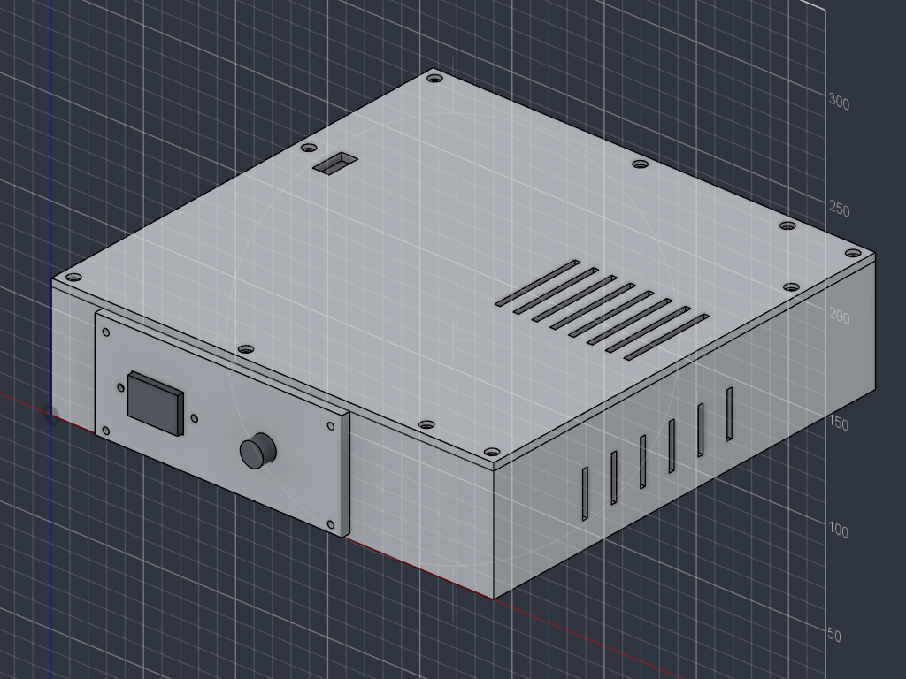 | 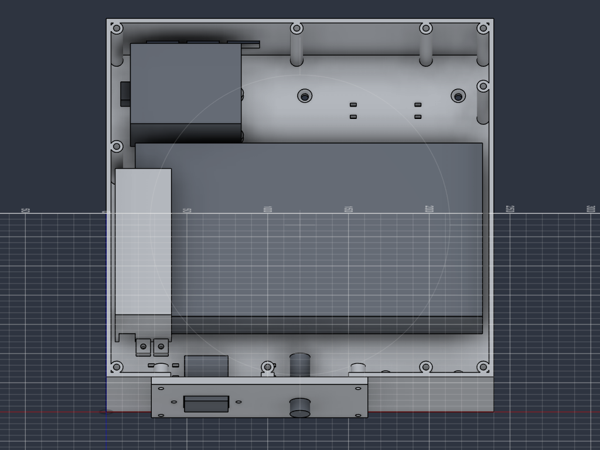 |
| Geschlossen: Netzblende vorne, Lüftung | Offen: Netzteil, Haube über der Klemmleiste, Dome für den Arduino |

Mehr dazu: [Beschreibung](docs/elektronikgehaeuse.md) · [Stückliste](docs/stuecklisten/elektronikgehaeuse.md) · [Gutachten](docs/reviews/2026-10-28-elektronikgehaeuse.md) · [GRBL-Einstellungen und Testprogramme](docs/grbl-j2.md) · [Messprotokoll](docs/messprotokoll-j2.md).

### Zubehör und Vorbereitung für später (Entwürfe, nichts gedruckt)

Sie wurden am 4. November von unabhängigen Gutachtern geprüft (drei Runden; die Noten gelten für das, was ohne die Kaufteile prüfbar ist). Alle Masse zu Kaufteilen (Schalter, ISO-Flansch, Magnete, Pogo-Pins, Kamera, Kettenglied) sind Startwerte; jedes Teil mit solchen Annahmen hat eine Probe oder eine Messvorschrift vor dem Druck.

- **Referenzschalter J2** ([Beschreibung](docs/zubehoer-j2.md)): Querträger mit Tasche für einen Mikroschalter KW12-3, der 0,4° vor dem mechanischen Anschlag auslöst (gerechnet, abhängig vom gekauften Schalter); dazu die Schalterprobe und eine Klemme für das Motorkabel. Der Querträger mit Schalter gilt nur für Messungen ohne grosse Last.
- **Greiferwechsler und Kamerahalter** ([Beschreibung](docs/werkzeugwechsler.md)): kinematische Kupplung (drei Kugeln in V-Nuten), Magnete, Pogo-Pins, Codierstift. Im CAD geprüft: Platten überschneiden sich nicht, Kugeln liegen in allen Nuten an, der Stift sperrt falsche Drehlagen. Die Haltekraft der Magnete reicht voraussichtlich nicht für 1 kg bei waagrechtem Werkzeug; die Magnetprobe liefert die Zahl.
- **Schiene: Kettenklemme** ([Beschreibung](docs/schiene-kabelfuehrung.md)): Notbehelf für eine Schleppkette ohne Anschlussstücke; besser ist die Kette mit Anschlussstücken zu kaufen. Die Rechnung zeigt zudem, dass 10 × 15 mm für alle Leitungen eines 6-Achs-Arms knapp ist.

Nicht gebaut und warum: ein Sicherungshalter für F1 ohne Löten (Reihenklemmen sind 57 mm tief, im Gehäuse sind 46 mm frei; [Befund](docs/elektronikgehaeuse.md)) und eine Drehmoment-Messvorrichtung (der Motorprüfstand und der Lasthebel messen es schon). Weitere offene Ideen: [Liste](docs/offene-ideen.md).

### Elektrik des Prüfstands (Entwurf)

Netzteil (Mean Well LRS-350-24) → Kfz-Sicherung 3 A → CNC-Shield mit TMC2209 → NEMA-17-Motor. Die 230-V-Seite ist ein Entwurf und wird von einem Elektriker geprüft, bevor etwas an Netzspannung angeschlossen wird. Das Schema gibt es zweimal aus derselben [Verdrahtungsliste](docs/schema/verdrahtung-j2.md): in KiCad (zum Lernen, [PDF](docs/schema/j2-pruefstand-kicad.pdf)) und in QElectroTech als Stromlaufplan (Datei `cad/qet/j2-pruefstand.qet`). Beide werden per Skript erzeugt.

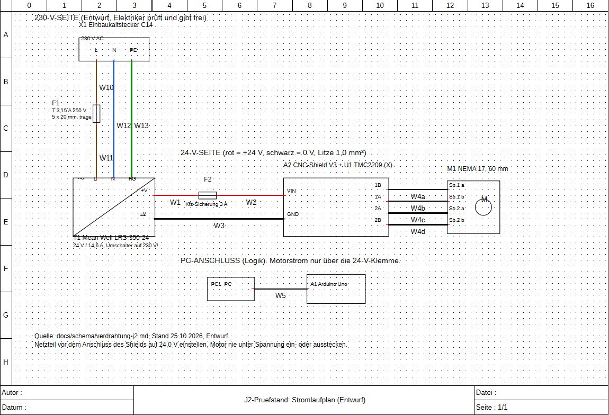

## Unterlagen

- [Konzept und Projektplan](docs/konzept.md)
- [Anforderungen](docs/anforderungen.md) und [Parameterliste](docs/parameter.md)
- [Lastrechnung](docs/lastrechnung.md)
- [Stückliste der Kaufteile](docs/bom.md)
- [Prüfstand Schultergelenk J2](docs/pruefstand-j2.md) mit [vollständiger Stückliste](docs/stuecklisten/pruefstand-j2.md) und [Bauanleitung (PDF)](docs/bauanleitung/Bauanleitung_J2_Pruefstand.pdf)
- [Motorvermessung](docs/motorvermessung.md) mit [Bauanleitung des Motorprüfstands (PDF)](docs/bauanleitung/Bauanleitung_Motorpruefstand.pdf) und [Stückliste](docs/stuecklisten/motorpruefstand.md)
- [Verdrahtung](docs/verdrahtung.md)
- [Elektronikgehäuse J2](docs/elektronikgehaeuse.md) mit [Stückliste](docs/stuecklisten/elektronikgehaeuse.md)
- [Aufbauanleitung J2 (Lieferung bis erster Test)](docs/aufbauanleitung-j2.md)
- [GRBL-Einstellungen J2](docs/grbl-j2.md) und [Messprotokoll J2](docs/messprotokoll-j2.md) · [Messanleitung mit Bildern](docs/messung-anleitung.html) · [Bohrbild für das Grundbrett](docs/bohrbild-brett.html)
- [Zubehör J2](docs/zubehoer-j2.md) mit [Stückliste](docs/stuecklisten/j2-zubehoer.md) · [Schiene: Kabelführung](docs/schiene-kabelfuehrung.md) mit [Stückliste](docs/stuecklisten/schiene-kette.md) · [Werkzeugwechsler und Kamerahalter](docs/werkzeugwechsler.md) mit [Stückliste](docs/stuecklisten/werkzeugwechsler.md) · [Offene Ideen](docs/offene-ideen.md)

**Gutachten.** Jede Idee und jede Baugruppe wird von einem unabhängigen Gutachter mit 1–10 bewertet, höchstens drei Runden:

- [Gesamtkonzept](docs/reviews/2026-10-11-konzept.md) · [Detailkonzept](docs/reviews/2026-10-11-detailkonzept.md)
- [Antrieb von Schulter und Ellbogen](docs/reviews/2026-10-11-antrieb-j2-j3.md) · [Steuerung für 7 Achsen](docs/reviews/2026-10-11-steuerung-7-achsen.md)
- [CAD des J2-Prüfstands](docs/reviews/2026-10-12-pruefstand-j2.md) · [Motorprüfstand](docs/reviews/2026-10-14-motorpruefstand.md) · [Elektronikgehäuse](docs/reviews/2026-10-28-elektronikgehaeuse.md)
- [Zubehör J2](docs/reviews/2026-11-04-j2-zubehoer.md) · [Werkzeugwechsler und Kamerahalter](docs/reviews/2026-11-04-werkzeugwechsler.md) · [Kettenklemme](docs/reviews/2026-11-04-schiene-kette.md)

**Dateien zum Nachbauen.** Die Druckteile des Prüfstands liegen als STL unter `cad/export/stl/J2_Pruefstand/`, die Baugruppe als STEP unter `cad/export/step/`. Die Geometrie entsteht aus dem Skript `cad/skripte/j2_pruefstand.py`, das die Baugruppe in Fusion 360 aufbaut. Die Teile des Motorprüfstands liegen unter `cad/export/stl/Motorpruefstand/`, erzeugt von `cad/skripte/motorpruefstand.py`.
